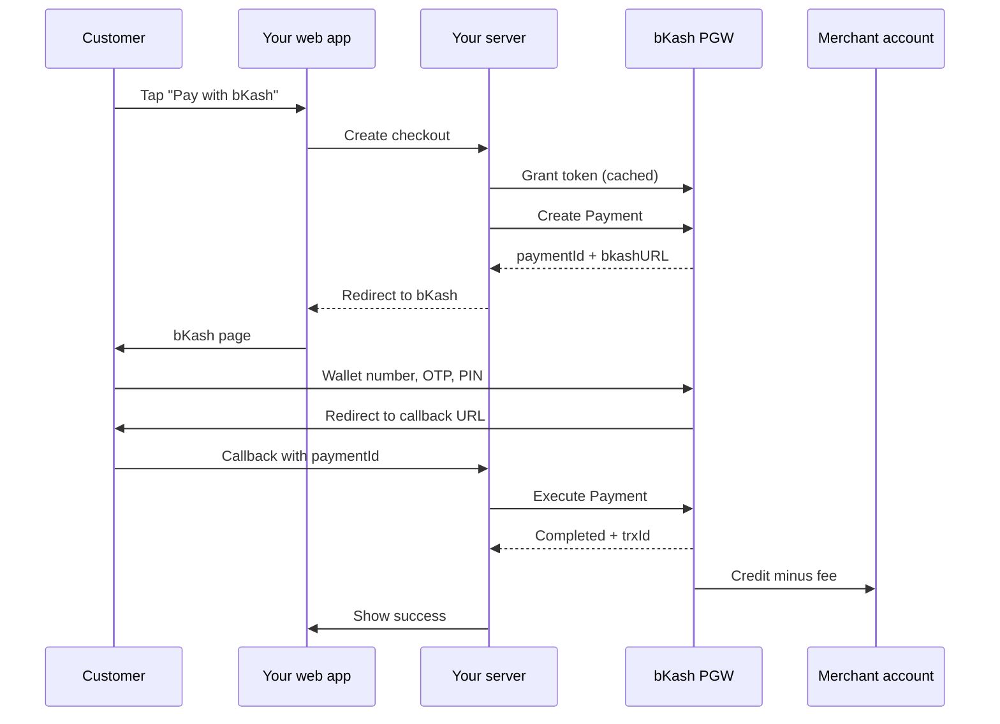
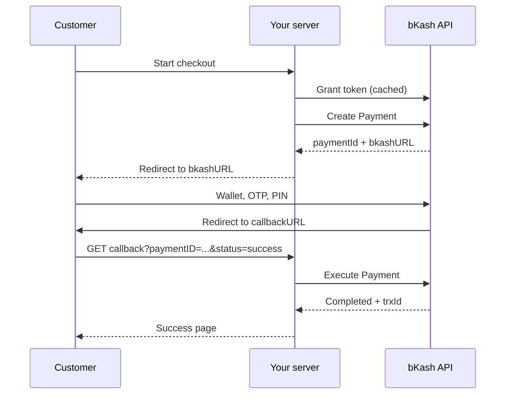
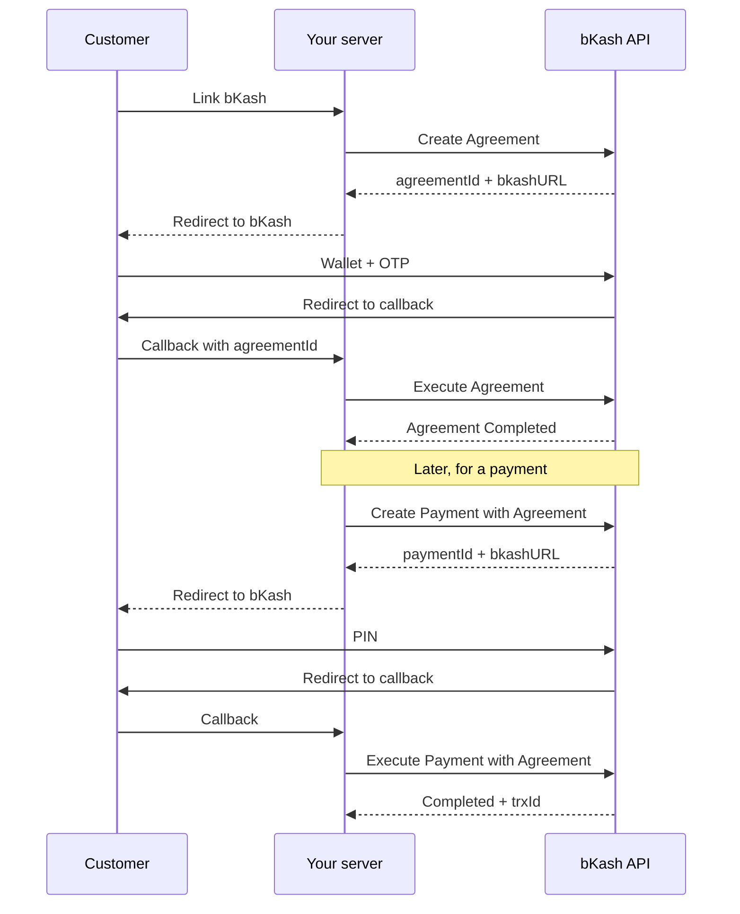
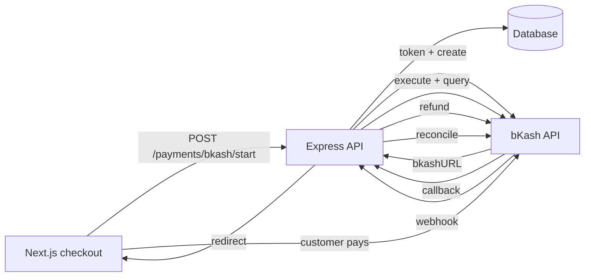
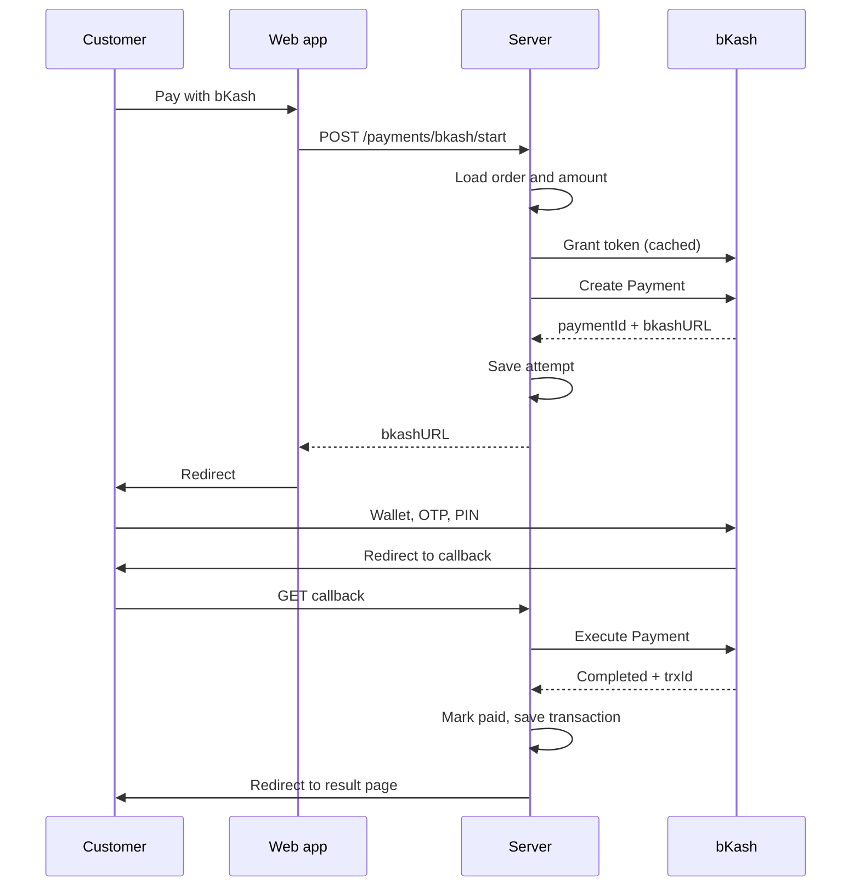
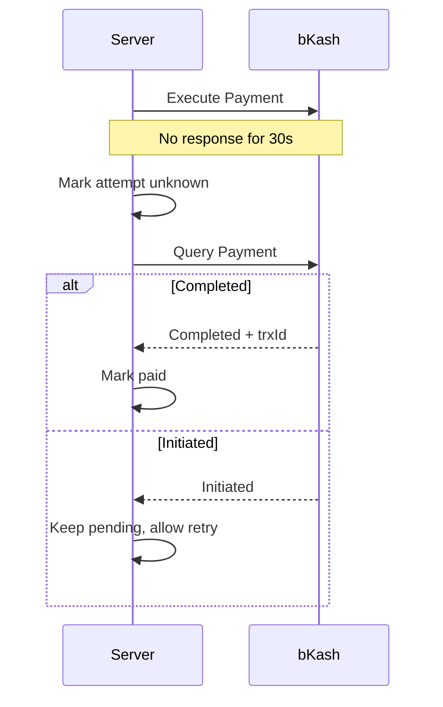
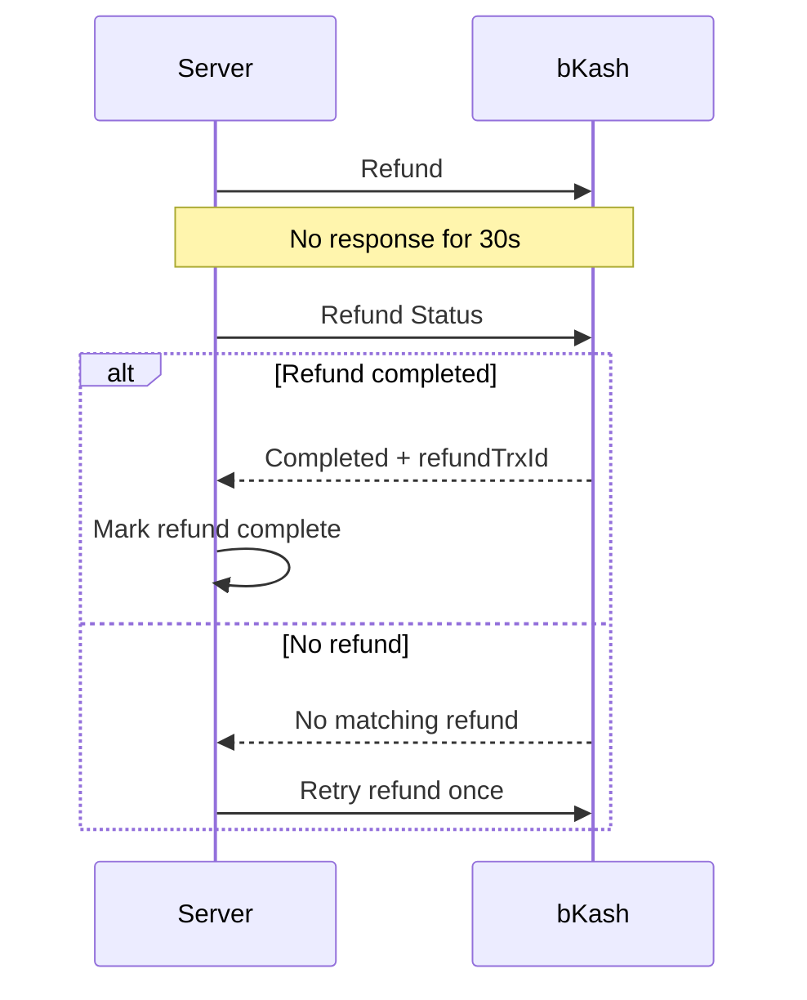

# bKash Payment Gateway from Zero

**A plain-language guide to theory, integration, failure handling, and production**

Version 1.0  
5 November 2026

---

## About this guide

This guide teaches bKash Payment Gateway integration to someone who has never worked with a payment gateway.

You do not need to know what a token, a callback, or a settlement report is. You need basic JavaScript, HTTP, and a terminal. Every payment term is defined before it is used.

The guide has three jobs:

1. Explain how money moves in an online payment.
2. Show how to build a correct bKash integration in TypeScript.
3. Teach you how to survive the failures that happen after the happy path works.

The happy path is short. Most of this guide covers the parts that wake you up at night: timeouts, duplicate callbacks, lost responses, partial refunds, and reports that do not match.

### What this guide is not

This is not official bKash documentation. It is an independent learning guide based on the public bKash developer documentation as of 5 November 2026. bKash can change endpoints, field names, limits, and rules. Always confirm the current details with your bKash onboarding pack and the official developer site.

This guide does not provide merchant credentials, live keys, or legal advice. Commercial terms such as the merchant discount rate, settlement cycle, and refund policy come from your agreement with bKash.

### How to read it

There are two paths.

**The fast path.** Read Chapters 1, 2, 14, 15, 17, 18, 19, and 31. Then build the sandbox lab in Chapter 29. This path gets one payment working.

**The full path.** Read in order. Do the labs. The later chapters assume you understand the state machine from Part 1.

Each chapter follows the same shape:

- A real scene.
- The plain-language idea.
- A diagram or table.
- The API or code.
- A "Production trap" box.
- A short exercise.

### Conventions

- `paymentId` is the bKash identifier for one payment attempt.
- `trxId` is the bKash identifier for a completed money movement.
- "Merchant" means you, the business accepting the payment.
- "Customer" means the person paying.
- "Sandbox" means the test environment.
- "Production" means the live environment with real money.
- Amounts are in Bangladeshi Taka (BDT) unless stated otherwise.
- Code is TypeScript. Every endpoint also has a `curl` example.

> **Warning:** Never put `app_secret`, `refresh_token`, or production credentials in browser code, mobile app code, screenshots, or logs. Treat them like database passwords.

---

## Contents

**Part 1. The ground floor**

1. A payment is a state machine
2. The players and the money path
3. Wallet money, bank money, and settlement
4. Authorization, capture, refund, and dispute
5. Why payment code fails

**Part 2. The bKash product map**

6. The product map
7. Checkout
8. Tokenized Checkout without agreement
9. Tokenized Checkout with agreement
10. Auth and Capture
11. Recurring charges, payouts, and other products
12. Choosing a product and onboarding

**Part 3. The core journey, API by API**

13. Architecture and trust boundaries
14. Grant Token and Refresh Token
15. Create Payment
16. The hosted bKash page
17. Callback
18. Execute Payment
19. Query Payment and the status machine
20. Webhook and IPN
21. Reconciliation

**Part 4. Build it in TypeScript**

22. Database schema
23. Order and payment state machines
24. The API client
25. Backend routes and services
26. Frontend checkout and return page
27. Refunds
28. Config, secrets, and environments
29. Sandbox lab
30. Test plan and failure injection

**Part 5. Production**

31. Idempotency, races, and duplicates
32. Timeouts, retries, and rate limits
33. Money, coupons, fees, and settlement
34. Security and privacy
35. Observability
36. Runbooks, incidents, and compliance

**Part 6. Edge cases**

37. Forty edge cases

**Part 7. Practice**

38. Six labs
39. Capstone
40. Final checklist

**Appendices**

A. Endpoint reference  
B. Field dictionary  
C. Error code table  
D. Sequence diagrams  
E. English and Bangla glossary  
F. Version notes and sources

---

# Part 1. The ground floor

## Chapter 1. A payment is a state machine

### The scene

Rina opens your shop on her phone. She adds a shirt to the cart. The price is BDT 1,250. She taps "Pay with bKash".

The screen changes. She enters her bKash wallet number. bKash sends a six-digit OTP to her phone. She enters the OTP. Then she enters her wallet PIN.

The screen says "Payment successful". Your shop shows the order. Rina closes the app.

That took about forty seconds. Behind those forty seconds, six systems exchanged messages, and one of them may have failed without anyone noticing.

### The button is the smallest part

Most beginners think the hard part is the "Pay" button. The button is easy. The hard part is the state of the payment after the button is pressed.

A payment is not one API call. It is a sequence of states. Each state has rules. Each move between states can fail. Your job is to make sure the payment can only move in valid ways.

Here is the full set of states for a simple sale:

```text
Cart
  |
  v
Order created
  |
  v
Payment initiated  (paymentId created)
  |
  v
Customer on bKash page
  |
  +---- customer cancels ------> Cancelled
  |
  +---- verification fails ----> Failed verification
  |
  v
Customer verified
  |
  v
Payment executed  (trxId created)
  |
  v
Paid
  |
  v
Fulfilled
  |
  v
Settled
  |
  v
Reconciled
```

Refunds create a separate branch:

```text
Paid
  |
  +---- full refund ----> Refunded
  |
  +---- partial refund -> Partially refunded
```

### Why the state machine matters

A state machine is a list of allowed statuses and allowed moves. It stops you from doing silly things, such as:

- Marking an order paid before bKash confirms the payment.
- Shipping an order twice because two callbacks arrived.
- Refunding a payment that was never completed.
- Treating a timeout as a failure.
- Letting a cancelled payment move back to "paid" because a late message arrived.

The state machine is the spine of the whole integration. The API calls are just the muscles.

### The five laws

The rest of this guide repeats five laws. Learn them now.

**Law 1. A timeout is not a failure. It is an unknown.**

If bKash does not answer in 30 seconds, you do not know what happened. The payment may have succeeded. The request may have failed. The response may be lost. You must ask bKash for the truth.

**Law 2. A callback is a signal, not proof.**

The browser callback tells you that the customer came back. It does not prove that money moved. Only Execute Payment or Query Payment can prove that.

**Law 3. Every retry needs an idempotency key.**

Doing the same action twice must have the same result as doing it once. Without this rule, a retry can create a second payment or a second refund.

**Law 4. Your database is the source of truth, not the browser.**

The browser can be refreshed, closed, spoofed, or replayed. Store every payment attempt and every state change on your server.

**Law 5. Money must reconcile, or the job is not done.**

A payment is not finished when the customer sees a success screen. It is finished when your records, bKash's records, and the settlement report agree.

### A note on "exactly once"

You will hear people say "the payment should happen exactly once". That is a goal, not a guarantee. Networks drop messages. Clients retry. Webhooks duplicate. You cannot force exactly-once delivery across the internet.

What you can do is make your system *effectively once*. You store a unique key for each action. You check the key before you act. You make the action safe to repeat. That is how real payment systems work.

### Production trap

The most common beginner bug is this:

```text
Call Execute Payment.
Request times out.
Mark the order as failed.
```

The payment may have succeeded. The customer may have been charged. Your order says failed. Now you have a support ticket, a refund, and a customer who does not trust you.

Correct behavior:

```text
Call Execute Payment.
Request times out.
Call Query Payment.
If status is Completed, mark the order paid.
If status is Initiated, the payment did not complete. You may retry from Create Payment.
```

### Exercise 1

Draw the state machine for your own checkout. Include these states: cart, order created, payment initiated, paid, fulfilled, cancelled, refunded. Mark the allowed moves. Mark the moves that must never happen.

---

## Chapter 2. The players and the money path

### The scene

Rina pays BDT 1,250. Her bKash balance goes down by 1,250. Your merchant balance goes up by 1,250 minus the fee. The shirt leaves your warehouse.

Three balances changed. One payment happened. Who moved the money?

### The players

A wallet payment has more players than a card payment, but the idea is similar.

| Player | What it does |
|---|---|
| Customer | Owns the bKash wallet and approves the payment |
| Merchant | Sells the goods or services and receives the money |
| bKash wallet | Holds the customer's stored value |
| bKash Payment Gateway | Accepts your API calls and runs the checkout |
| Merchant account | Holds your received funds inside bKash |
| Settlement bank | Moves money between institutions when needed |
| Regulator | Sets the rules, such as Bangladesh Bank |
| Your server | Creates the payment, verifies it, and records it |
| Your database | Stores orders, attempts, transactions, and refunds |

The customer does not send money to your server. Your server never touches the PIN or OTP. bKash handles the sensitive part on its own page.

That separation is good. It keeps your code out of the most dangerous part of the payment.

### The money path



### What each player knows

The customer knows that she paid. She may not know which merchant account received the money.

Your server knows the order, the payment attempt, and the bKash response. It does not know the customer's wallet balance.

bKash knows the wallet, the merchant, the amount, the fee, and the transaction. It does not know your order contents.

Your database knows what you chose to store. If you do not store the payment ID and the transaction ID, you will struggle later.

### The most important mapping

You need a clear link between three identifiers:

| Identifier | Created by | Meaning |
|---|---|---|
| `orderId` | Your system | The thing the customer bought |
| `paymentId` | bKash | One payment attempt |
| `trxId` | bKash | One completed money movement |

One order can have many payment attempts. A customer may cancel, retry, and succeed. One successful payment has one `trxId`.

Never use `trxId` as your order ID. Never use your order ID as `paymentId`. Keep them separate and store the links.

### A simple ledger view

Here is what happens to the balances in a simplified sale:

| Step | Customer wallet | Merchant account | Fee |
|---|---:|---:|---:|
| Start | 5,000 | 10,000 | 0 |
| Customer pays 1,250 | 3,750 | 10,000 | 0 |
| bKash credits merchant | 3,750 | 11,250 | 0 |
| bKash takes fee | 3,750 | 11,231.25 | 18.75 |

The exact fee is set by your agreement. The table uses 1.5% only as an example. Do not hard-code a fee rate from a blog post.

### Production trap

Do not assume that "payment completed" means "money is available". The payment can complete today and settle later. Your order can be fulfilled before settlement, but your finance report must know the difference.

### Exercise 2

Take your last online purchase. Write down the order ID, the payment reference, and the receipt number. Which one did the merchant create? Which one did the payment provider create?

---

## Chapter 3. Wallet money, bank money, and settlement

### The scene

Your dashboard says "BDT 50,000 received today". Your bank account says "BDT 48,500". The difference is not a bug. It is the fee and the settlement cycle.

### Wallet money is a liability

When a customer tops up a bKash wallet, bKash owes that customer money. The wallet balance is a liability on bKash's books. When the customer pays you, bKash moves the liability from the customer to you.

Your merchant account is also a balance inside bKash. It is not the same as your bank account. You may need to withdraw or settle it according to your agreement.

This matters because "money in the merchant account" and "money in your bank" are different states. A payment can be complete while settlement is still pending.

### The four money events

| Event | Plain meaning | When it happens |
|---|---|---|
| Authorization | The customer approves the payment | Customer enters PIN and OTP |
| Capture | The money is taken from the wallet | bKash completes the debit |
| Settlement | The merchant is credited, minus fees | According to the settlement cycle |
| Reconciliation | Your records match the provider's records | After settlement, usually daily |

In a simple bKash sale, authorization and capture happen close together. In an Auth and Capture product, they are separate. You hold funds first and capture later.

### Settlement is not instant

Settlement has three parts:

1. **Timing.** The provider may settle on the same day, the next day, or later. Your agreement defines this.
2. **Fees.** The merchant discount rate (MDR) is deducted. VAT or other charges may apply.
3. **Reports.** The provider gives you a file or portal view with transactions, fees, and net amounts.

Your code should store the gross amount, the fee, and the net amount separately. Do not overwrite the gross amount with the net amount.

### A settlement example

| Field | Value |
|---|---:|
| Gross payment | 1,250.00 |
| MDR (example only) | 1.5% |
| Fee | 18.75 |
| Net settlement | 1,231.25 |
| Trx ID | DIK20PG0H4 |

If your order says 1,250 and your bank says 1,231.25, you need the fee line to explain the difference. Without it, every settlement looks like a loss.

### Reconciliation

Reconciliation is the practice of comparing three things:

1. Your database: what you think happened.
2. bKash's transaction records: what bKash says happened.
3. Your settlement report or bank statement: what actually arrived.

The goal is to find and explain every difference. Differences are normal. Unexplained differences are not.

Common difference types:

- A payment succeeded but your callback was lost.
- A refund was issued twice.
- A fee was higher than expected.
- A transaction settled in a different period.
- A test transaction appeared in a live report.
- A charge was reversed after settlement.

### Production trap

Do not build your finance report from the browser. Build it from your database, then reconcile against bKash. The browser is a display, not a ledger.

### Exercise 3

Write down three numbers for a recent sale: gross amount, fee, net amount. If you cannot find the fee, that is the first gap your integration should fix.

---

## Chapter 4. Authorization, capture, refund, and dispute

### The scene

A customer buys a ticket for next Friday. You do not want to charge him today if the event may be cancelled. You want to hold the money, then capture it when the booking is confirmed.

That is authorization and capture.

### Sale, authorization, and capture

| Model | What happens | Good for |
|---|---|---|
| Sale | Authorize and capture in one step | Normal checkout |
| Authorization | Hold funds, capture later | Bookings, pre-orders, services |
| Capture | Take the held funds | When the service is confirmed |
| Void | Release the hold before capture | Cancellation before capture |

In bKash's product map, Auth and Capture is a separate product. Do not assume that a normal sale can be split into two steps. Check your product and your agreement.

### Refund

A refund returns money after a capture. It can be full or partial. bKash's v2 refund API supports multiple partial refunds against the same transaction, up to the maximum refundable amount, within the refund window.

Important fields:

- `paymentId`: the original payment.
- `trxId`: the original transaction.
- `refundAmount`: the amount to return.
- `sku`: your product tag.
- `reason`: why you are refunding.

The response gives you a `refundTrxId`. Store it. A refund is a new money movement, not an edit to the original payment.

### Refund rules to respect

The public docs state these limits for the v2 refund API:

- The refund window is 60 days from the original transaction.
- You can issue up to 10 partial refunds against one transaction.
- The total refunded amount cannot exceed `maxRefundableAmount`.
- A duplicate refund for the same amount is blocked for 10 minutes.
- If the refund call times out, call Refund Status before retrying.

These rules change. Confirm them in your onboarding pack.

### Void versus refund

A void cancels a hold before capture. A refund returns money after capture. They are not the same operation, and they may not use the same endpoint.

If you void a hold, the customer should see the hold released. If you refund a capture, the customer should see a credit.

### Disputes

Card payments have chargebacks. Wallet payments work differently. A bKash customer may raise a complaint through bKash support. Your business may need to provide evidence: order details, delivery proof, chat logs, and refund records.

You cannot code your way out of a dispute. You can keep good records so the dispute is easy to answer.

### Production trap

Do not issue a refund just because the customer asks for one in chat. Check the payment status, the refundable amount, and the refund window first. A refund against a payment that is still `Initiated` will fail or create a mess.

### Exercise 4

List three situations in your business that need a hold instead of a direct charge. If you cannot find three, you probably do not need Auth and Capture.

---

## Chapter 5. Why payment code fails

### The scene

Your integration works in sandbox. You deploy. The first real customer pays. The success page shows an error. The customer sends a screenshot. Your logs show nothing.

Welcome to payment engineering.

### The eight failure classes

Most payment bugs fall into eight groups.

| Class | Example | Typical fix |
|---|---|---|
| Network timeout | bKash does not answer in 30 seconds | Query before deciding |
| Duplicate delivery | Two callbacks for one payment | Idempotency key |
| Out-of-order events | Callback arrives before your database commit | Store first, process later |
| Lost event | Callback never arrives | Reconciliation job |
| Human behavior | Customer closes the tab after paying | Query on return and in the background |
| Provider outage | bKash returns 503 | Retry with backoff, show a clear message |
| Money mismatch | Fee or coupon changes the net amount | Store gross, fee, and net separately |
| Security failure | Secret leaks or callback is spoofed | Server-only secrets, verify with bKash |

### What you think versus what is true

| You think | What may be true |
|---|---|
| "The API returned an error, so the payment failed." | The request failed, but the payment may have succeeded. |
| "The callback said success, so the payment is done." | The customer verified, but Execute Payment may still be pending. |
| "The webhook arrived twice, so two payments happened." | One payment happened. The message was duplicated. |
| "The customer closed the tab, so he did not pay." | He may have paid and never returned. |
| "The refund failed, so no money moved." | The refund may have succeeded and the response was lost. |
| "The amount is a number, so 0.1 + 0.2 is 0.3." | Floating point says otherwise. Use decimal strings or integer paisa. |

### The unknown state

The most important idea in this chapter is the unknown state.

When a request times out, the result is not success and not failure. It is unknown. You must resolve the unknown before you change the order.

```text
Known success
Known failure
Unknown  <-- most production incidents live here
```

Your system needs a way to resolve unknowns:

- Query Payment by `paymentId`.
- Search Transaction by `trxId`.
- Check the settlement report.
- Ask bKash support with the `paymentId` and `trxId`.

### The three clocks

A payment has three clocks:

1. **The customer's clock.** How long will she wait before closing the app?
2. **The API clock.** The 30-second timeout.
3. **The settlement clock.** When the money arrives.

Your UI, your retries, and your reports must respect all three. A payment can be complete on the API clock and still pending on the settlement clock.

### Production trap

Do not write this:

```ts
try {
  const result = await executePayment(paymentId);
  markOrderPaid(result);
} catch (error) {
  markOrderFailed(error);
}
```

The `catch` block is wrong. A timeout is not a failure. Replace it with a query and a state transition.

### Exercise 5

Find one place in your current code where a timeout is treated as a failure. Write down how you will resolve the unknown instead.

---

# Part 2. The bKash product map

## Chapter 6. The product map

### The scene

You open the bKash developer site. You see Checkout, Tokenized Checkout, Agreement, Auth and Capture, Direct Charge, Payout, M2M, A2M, QR, and Dynamic Charging. You close the tab and make tea.

This chapter gives you the map.

### The products in plain language

| Product | Customer experience | Best for | Relative complexity |
|---|---|---|---|
| Checkout | Redirect to bKash, enter wallet, OTP, PIN | Simple one-time payments | Low |
| Tokenized Checkout without agreement | Same as Checkout, but you control create and execute | Most custom checkouts | Medium |
| Tokenized Checkout with agreement | Customer links wallet once, later pays with PIN only | Repeat customers, subscriptions | High |
| Auth and Capture | Hold funds, capture later | Bookings, pre-orders, services | High |
| Direct Charge | Automatic deduction after consent | Recurring bills, subscriptions | High |
| B2B Payout | Send money to another merchant | Supplier payouts, marketplace splits | Medium |
| M2M | Merchant pays another merchant | Business payments | Medium |
| A2M | Agent pays a merchant | Agent-assisted commerce | Medium |
| QR | Customer scans a QR code | In-person or app-to-app | Low |
| Dynamic Charging | Add a service fee at checkout | Fee-based services | Medium |

The names and availability depend on your merchant category and your contract. Not every product is enabled for every merchant.

### The three questions that choose the product

Ask these in order:

1. **Does the customer pay once, or many times?**
   - Once: Checkout or Tokenized Checkout.
   - Many times: Agreement, Direct Charge, or subscription.

2. **Do you need to hold the money before charging?**
   - Yes: Auth and Capture.
   - No: normal sale.

3. **Who is paying whom?**
   - Customer to merchant: Checkout or Tokenized.
   - Merchant to merchant: B2B Payout or M2M.
   - Agent to merchant: A2M.

### What "tokenized" means

A token is a reference to something sensitive. In bKash Tokenized Checkout, the token is not the customer's card number. It is a payment or agreement reference that bKash issues.

There are two kinds:

- **Payment token.** A `paymentId` that represents one payment attempt.
- **Agreement token.** An `agreementId` that represents a customer's consent to future charges.

Do not confuse either one with the API access token from Grant Token. That is a third kind of token, and it expires in 60 minutes.

### The product map is not a menu

You do not pick the most impressive product. You pick the one that matches your business and your contract.

A simple shop needs Checkout or Tokenized Checkout. A subscription business needs an agreement or Direct Charge. A marketplace needs splits and payouts. A restaurant needs QR. Do not add Auth and Capture because it sounds advanced.

### Production trap

The product names in blog posts are often out of date. A tutorial may call something "Subscription" while the current docs call it "Direct Charge" or "Agreement". Match the product to the API endpoints in your onboarding pack, not to the label in a YouTube video.

### Exercise 6

Write one sentence about your business. Then choose the simplest product that fits. If you need two products, write down why.

---

## Chapter 7. Checkout

### The scene

You want the smallest possible integration. You do not want to manage tokens, execute calls, or payment state. You want a payment link or a redirect.

Checkout is that product.

### How it works

1. Your server asks bKash to create a checkout.
2. bKash returns a URL.
3. You redirect the customer to the URL.
4. The customer enters wallet number, OTP, and PIN on bKash's page.
5. bKash handles the payment and redirects the customer back.
6. You verify the result.

The exact API shape depends on the Checkout variant. In some variants, bKash executes the payment for you. In others, you still call Execute Payment. Read your product's flow before you code.

### When to use it

Use Checkout when:

- You need one-time payments.
- You want bKash to host most of the flow.
- You do not need a saved agreement.
- You want a small integration surface.

Do not use it when:

- You need repeat charges without the customer present.
- You need to hold funds before capture.
- You need a custom payment page inside your app.

### What you still must do

Checkout does not remove your responsibility for state. You still need to:

- Store the order and the payment reference.
- Verify the result on your server.
- Handle cancellation and failure.
- Reconcile later.

A hosted page is not a hosted business.

### Production trap

Do not redirect the customer to a URL you built yourself. Use the exact URL returned by bKash. The URL contains a signed hash. If you change it, the payment will fail.

### Exercise 7

Open the bKash Checkout documentation for your account. Write down which step executes the payment. If the docs are unclear, ask your bKash integration contact before you write code.

---

## Chapter 8. Tokenized Checkout without agreement

### The scene

You want control. You want your own checkout page, your own return page, and your own state machine. You do not need to save the customer's wallet for later.

Tokenized Checkout without agreement is the usual choice.

### The flow



### The steps

1. **Get an access token.** Cache it. Do not request a new token for every payment.
2. **Create the payment.** Send the amount, currency, intent, invoice number, payer reference, and callback URL.
3. **Store the response.** Save `paymentId`, `bkashURL`, amount, invoice number, and status.
4. **Redirect the customer.** Use the exact `bkashURL`.
5. **Receive the callback.** Read the payment ID and status.
6. **Execute the payment.** Call Execute Payment on your server.
7. **Confirm.** Mark the order paid only after `Completed`.
8. **Record.** Save `trxId`, payer account, amount, and timestamps.

### What the customer sees

The customer sees bKash's page, not yours. The page asks for:

1. Wallet number.
2. OTP sent to the registered phone.
3. Wallet PIN.

You never see the OTP or PIN. Do not ask for them. Do not build a form that collects them.

### The 24-hour payment ID

A `paymentId` is valid for 24 hours from creation. It can be executed only once. After an execute attempt, it cannot be reused, even if the attempt failed.

That last point is sharp. If you call Execute Payment with the wrong payload, you may burn the payment ID. The customer may need a new payment attempt.

### Production trap

Do not send the customer to bKash and then wait for a webhook to execute the payment. The execute call is part of the checkout flow. If you wait too long, the customer sees a stuck screen.

### Exercise 8

Write the exact sequence of database writes for one payment. Include the create, callback, execute, and confirmation steps.

---

## Chapter 9. Tokenized Checkout with agreement

### The scene

A customer buys coffee from your app every morning. He does not want to enter his wallet number and OTP every time. He wants to tap "Pay" and enter his PIN.

An agreement makes that possible.

### What an agreement is

An agreement is a record that the customer has linked his bKash wallet to your merchant account and consented to future charges. bKash returns an `agreementId`. You store it against the customer.

The agreement does not mean you can charge any amount at any time. It means the customer can approve future charges with a PIN, or in some products, without a PIN. The exact rules depend on the product and the consent.

### The flow



### The five agreement APIs

| Step | Endpoint | Purpose |
|---|---|---|
| Create | `POST /agreement/create` | Start linking, returns `agreementId` and `bkashURL` |
| Execute | `POST /agreement/execute` | Complete the link after customer verification |
| Charge | `POST /payment-with-agreement/create` | Start a payment against the agreement |
| Charge | `POST /payment-with-agreement/execute` | Complete the payment |
| Cancel | `POST /agreement/cancel` | Revoke the agreement |

The exact paths are in Appendix A. Always confirm them against your onboarding pack.

### When to use an agreement

Use an agreement when:

- The customer will pay more than once.
- You want a faster repeat checkout.
- You need a saved payment method.
- You can handle consent, cancellation, and data retention.

Do not use it when:

- The customer pays once.
- You cannot explain the consent clearly.
- You cannot store the `agreementId` safely.
- Your business cannot handle revocation.

### Cancellation

A customer can unlink your app from the bKash app. Your server may not know immediately. Build a cancellation path and a "refresh agreement status" job.

Do not assume that a stored `agreementId` is active forever. Check its status before a charge. Handle `Cancelled` and invalid agreement errors.

### Production trap

An agreement is not a blank cheque. Charge only the amount the customer agreed to, and only for the purpose in your terms. A surprising charge leads to complaints and lost trust.

### Exercise 9

Write the consent sentence a customer would read before linking their wallet. Keep it under 40 words. If you cannot explain it simply, do not ship the feature.

---

## Chapter 10. Auth and Capture

### The scene

A customer books a hotel room for next month. You want to reserve BDT 8,000 now, but charge only when he checks in. If he cancels, you release the hold.

That is authorization and capture.

### The two steps

| Step | What happens | Money moves? |
|---|---|---|
| Authorize | Customer approves, funds are held | Not yet |
| Capture | Merchant takes the held funds | Yes |
| Void | Merchant releases the hold | No |

A normal sale combines authorize and capture. Auth and Capture separates them.

### When to use it

Use Auth and Capture when:

- The final amount may change.
- The service happens later.
- You need to verify the customer before charging.
- You need a hold instead of a charge.

Do not use it when:

- You deliver immediately.
- The amount is fixed.
- Your contract does not enable it.

### The hard parts

1. **Hold expiry.** A hold does not last forever. Check the expiry rules.
2. **Partial capture.** You may capture less than the authorized amount. Confirm the rules.
3. **Multiple captures.** Some products allow more than one capture. Do not assume.
4. **Void window.** A void must happen before capture. After capture, you need a refund.
5. **Customer confusion.** A hold may look like a charge in the customer's app. Explain it.

### Production trap

Do not capture more than the authorized amount. Do not capture after the hold expires. Do not use Auth and Capture as a way to "test" a customer's balance without telling them.

### Exercise 10

Write the customer message that explains a hold. It should say the amount, why you are holding it, and when you will capture it.

---

## Chapter 11. Recurring charges, payouts, and other products

### Recurring charges and Direct Charge

A recurring charge takes money on a schedule. The customer consents once, and you charge later.

Direct Charge is bKash's product for automatic deductions after consent. The customer links the wallet, and future charges may not need a PIN. The exact flow and limits depend on your contract.

Use recurring charges only when:

- The customer understands the schedule.
- The amount or the maximum amount is clear.
- You provide an easy cancellation path.
- You send a receipt for every charge.

### B2B Payout

B2B Payout sends money from your merchant account to another bKash merchant. It is useful for supplier payments, marketplace seller payouts, and refunds outside the original payment flow.

The receiver does not need to be a PGW merchant. Your contract must enable the product.

### M2M

M2M means merchant to merchant. One merchant pays another. It is not the same as a customer payment. Eligibility is limited to certain merchant categories.

### A2M

A2M means agent to merchant. An agent pays a merchant through the gateway. The customer may be present, but the payer is an agent account.

### QR

A QR payment lets the customer scan a code. The QR may be static or dynamic. The payment is still a bKash wallet payment, but the entry point is different.

### Dynamic Charging

Dynamic Charging adds a service or convenience fee at checkout. The customer sees the fee breakdown on the bKash page. The fee is deducted at payment time and distributed to the beneficiaries.

Use it only when your contract allows it and the fee is transparent.

### Production trap

Do not mix product names in your code. A "payout" is not a "refund". An "agreement charge" is not a "checkout". Each product has its own endpoints, limits, and reports.

### Exercise 11

List the products your business actually needs for the next 12 months. Put everything else on a "later" list.

---

## Chapter 12. Choosing a product and onboarding

### The decision tree

```text
Does the customer pay once?
  |
  +-- Yes --> Do you need to hold funds before capture?
  |             |
  |             +-- Yes --> Auth and Capture
  |             |
  |             +-- No  --> One-time checkout
  |                         |
  |                         +-- Want bKash to host most of it? --> Checkout
  |                         |
  |                         +-- Want your own flow? -----------> Tokenized Checkout
  |
  +-- No --> Do you need automatic charges?
                |
                +-- Yes --> Agreement or Direct Charge
                |
                +-- No  --> Tokenized Checkout with saved agreement
```

### Onboarding checklist

Before you write code, collect these items:

- Merchant account and contract.
- Sandbox credentials: `app_key`, `app_secret`, username, password.
- Production credentials, kept separate.
- Approved callback domains.
- Product enablement for the features you need.
- MDR, settlement cycle, and fee treatment.
- Refund policy and support contact.
- Test wallet numbers, if bKash provides them.
- Branding rules for the bKash button and logo.

### Sandbox versus production

| Area | Sandbox | Production |
|---|---|---|
| Money | Test money | Real money |
| Credentials | Test keys | Live keys |
| Callback URL | Public tunnel is usually fine | Public HTTPS domain, approved by bKash |
| Support | Limited | Contractual |
| Data | Test data | Real customer data |
| Risk | Low | High |

Sandbox is not a perfect copy of production. Some limits, fees, and edge cases appear only in production. Test what you can, and monitor what you cannot.

### The onboarding delay

Merchant onboarding can take days or weeks. Start early. Do not wait until the week before launch to request credentials or domain approval.

### Production trap

Do not use production credentials in a sandbox test. Do not use sandbox credentials in production. Keep two sets of environment variables and two sets of callback URLs.

### Exercise 12

Make a table with four columns: item, owner, status, date. Put every onboarding item in it. Share it with your bKash contact.

---

# Part 3. The core journey, API by API

## Chapter 13. Architecture and trust boundaries

### The scene

Your checkout page is a browser tab. Your API is a server. bKash is another company's server. The customer's phone is a third device. Four computers must agree on one payment.

### The components

```text
+-------------------+        +-------------------+        +-------------------+
| Customer browser  |  HTTPS | Your web server   |  HTTPS | bKash API         |
| or mobile app     |<------>| (Express)         |<------>| (tokenized host)  |
+-------------------+        +-------------------+        +-------------------+
                                     |
                                     | private network
                                     v
                              +-------------------+
                              | Your database     |
                              +-------------------+
```

### Trust boundaries

| Boundary | What crosses it | Trust rule |
|---|---|---|
| Browser to your server | Order ID, user session, UI intent | Never trust the amount or status from the browser |
| Your server to bKash | Credentials, payment requests | Authenticate every call, keep secrets server-side |
| bKash to your callback | Payment ID and status in a URL | Treat it as a signal, then verify |
| bKash to your webhook | SNS message | Verify the signature before you act |
| Your server to your database | State changes | Use transactions, unique keys, and guards |

### The rule that prevents most bugs

The browser may ask. The server decides.

A browser can send `amount: 1` for a BDT 50,000 order. If your server trusts it, you lose money. Always load the order from the database and use the stored amount.

```ts
// Wrong
const amount = req.body.amount;

// Right
const order = await orderRepository.findById(req.body.orderId);
if (!order) throw new Error("Order not found");
const amount = order.total;
```

### Where secrets live

| Secret | Where it lives | Where it must never live |
|---|---|---|
| `app_key` | Server environment | Browser, mobile app, logs |
| `app_secret` | Server environment or secret manager | Browser, mobile app, logs |
| bKash username | Server environment | Browser, mobile app, logs |
| bKash password | Server environment or secret manager | Browser, mobile app, logs |
| `refresh_token` | Server-side store, encrypted | Browser, mobile app, logs |
| Database URL | Server environment | Client bundle |

### The callback is a public door

Your callback URL is reachable by anyone. A stranger can open it with fake query parameters. That is why the callback must not mark an order paid by itself. It must trigger a server-side verification call.

### Production trap

Do not put the bKash API base URL, `app_key`, or any token in client-side JavaScript. A bundled secret is not a secret. Anyone can open developer tools and read it.

### Exercise 13

Draw your own architecture. Mark every place where data crosses a trust boundary. Write one rule for each crossing.

---

## Chapter 14. Grant Token and Refresh Token

### The scene

You call Create Payment. bKash says "invalid credentials". You forgot the access token. You add a Grant Token call before every payment. It works in sandbox. In production, it breaks after a few minutes.

### What the token is

The access token is a short-lived pass. It proves that your request comes from an approved application. You send it in the `Authorization` header on every bKash API call.

The token is not the customer's token. It is your application's token.

### The endpoint

```http
POST /v2/tokenized-checkout/auth/grant-token
Content-Type: application/json
username: <merchant username>
password: <merchant password>

{
  "app_key": "<app key>",
  "app_secret": "<app secret>"
}
```

Sandbox example:

```bash
curl --location 'https://tokenized.sandbox.bka.sh/v2/tokenized-checkout/auth/grant-token' \
  --header 'username: YOUR_USERNAME' \
  --header 'password: YOUR_PASSWORD' \
  --header 'Content-Type: application/json' \
  --data '{
    "app_key": "YOUR_APP_KEY",
    "app_secret": "YOUR_APP_SECRET"
  }'
```

Success response:

```json
{
  "statusCode": "0000",
  "statusMessage": "Successful",
  "token_type": "Bearer",
  "id_token": "eyJ...",
  "refresh_token": "eyJ...",
  "expires_in": 3600
}
```

### The numbers that matter

| Item | Value | Consequence |
|---|---|---|
| Access token lifetime | 3600 seconds (60 minutes) | Refresh before it expires |
| Refresh token lifetime | 30 days | Store it safely |
| Grant or refresh calls | Maximum 2 per hour | Cache and single-flight |
| Exceeding the limit | App blocked for 1 hour | All payments fail |

The 2-per-hour limit is the trap that catches everyone. If you call Grant Token for every checkout, you will hit the limit during a busy hour. Then your app is blocked for an hour.

### The right design

```text
App start
  |
  v
Load token from cache
  |
  +-- token valid for more than 5 minutes --> use it
  |
  +-- token missing or near expiry --> refresh or grant
                                        |
                                        v
                                  save token + expiry
```

Use one shared token manager per process. If you run more than one server instance, use a shared lock such as Redis, or a scheduled job that refreshes once and writes the token to a shared store.

### A simple token manager

```ts
type GrantResponse = {
  statusCode: string;
  statusMessage: string;
  token_type: string;
  id_token: string;
  refresh_token: string;
  expires_in: number;
};

export class BkashTokenManager {
  private token: string | null = null;
  private refreshToken: string | null = null;
  private expiresAt = 0;
  private inFlight: Promise<string> | null = null;

  constructor(
    private readonly baseUrl: string,
    private readonly appKey: string,
    private readonly appSecret: string,
    private readonly username: string,
    private readonly password: string,
  ) {}

  async getToken(): Promise<string> {
    const safetyWindow = 5 * 60_000;
    if (this.token && Date.now() < this.expiresAt - safetyWindow) {
      return this.token;
    }

    if (this.inFlight) {
      return this.inFlight;
    }

    this.inFlight = this.acquireToken().finally(() => {
      this.inFlight = null;
    });

    return this.inFlight;
  }

  private async acquireToken(): Promise<string> {
    const body = this.refreshToken
      ? {
          app_key: this.appKey,
          app_secret: this.appSecret,
          refresh_token: this.refreshToken,
        }
      : {
          app_key: this.appKey,
          app_secret: this.appSecret,
        };

    const path = this.refreshToken ? "/auth/refresh-token" : "/auth/grant-token";

    const response = await fetch(`${this.baseUrl}${path}`, {
      method: "POST",
      headers: {
        "Content-Type": "application/json",
        username: this.username,
        password: this.password,
      },
      body: JSON.stringify(body),
      signal: AbortSignal.timeout(30_000),
    });

    if (!response.ok) {
      throw new Error(`bKash token request failed: ${response.status}`);
    }

    const data = (await response.json()) as GrantResponse;

    if (data.statusCode !== "0000" || !data.id_token) {
      throw new Error(`bKash token error: ${data.statusCode} ${data.statusMessage}`);
    }

    this.token = data.id_token;
    this.refreshToken = data.refresh_token;
    this.expiresAt = Date.now() + data.expires_in * 1000;

    return this.token;
  }
}
```

This class is deliberately small. In production, add:

- A distributed lock so two instances do not refresh at the same time.
- Encryption at rest for the refresh token.
- Alerting when the token endpoint fails.
- A metric for token age.

### Why a timeout is not a token failure

If the token request times out, do not immediately call it again. You may hit the 2-per-hour limit. Check whether the request reached bKash. If you cannot tell, wait and retry with backoff.

A refresh can fail because the refresh token expired or was revoked. Handle that once: clear the stored refresh token and call Grant Token. If Grant Token also fails, stop and alert. Do not loop between refresh and grant. A loop burns the 2-per-hour limit and blocks the app.

### The `Authorization` header format

The v2 samples send the raw `id_token` in the `Authorization` header. Some bKash documentation describes it as a Bearer token. HTTP header values are not always consistent across versions.

Use the exact form in your onboarding pack. If you receive `2001` or `9999`, test the other form in sandbox before you change production code.

### Production trap

Do not store the access token in a database row and update it from every request. That creates a write storm and race conditions. Store it in memory per instance, or in a shared cache with a lock.

### Exercise 14

Write a test that calls `getToken()` 100 times in parallel. Assert that the token endpoint is called once. This is the single-flight test.

---

## Chapter 15. Create Payment

### The scene

You have a token. You create a payment for BDT 1,250. bKash returns a long URL. You send the customer to that URL. The customer pays.

This is the first API call that touches an order.

### The endpoint

```http
POST /v2/tokenized-checkout/payment/create
Authorization: <id_token>
X-App-Key: <app_key>
Content-Type: application/json
```

### The body

```json
{
  "payerReference": "CUSTOMER-123",
  "callbackURL": "https://shop.example.com/api/payments/bkash/callback",
  "amount": "1250.00",
  "currency": "BDT",
  "intent": "sale",
  "merchantInvoiceNumber": "INV-2026-000123"
}
```

### Field by field

| Field | Required | What it means | Practical rule |
|---|---|---|---|
| `payerReference` | Yes | A reference for the payer | Use your customer ID, not a phone number, unless you need prefill |
| `callbackURL` | Yes | Where bKash sends the customer after verification | Public HTTPS URL, no query string you cannot handle |
| `amount` | Yes | Payment amount | Send a string with two decimals |
| `currency` | Yes | Currency code | `BDT` |
| `intent` | Yes | Payment intent | `sale` for a normal checkout |
| `merchantInvoiceNumber` | Yes | Your invoice ID | Unique per payment attempt |
| `subMerchantName` | No | Aggregator sub-merchant name | Only for aggregators |
| `merchantAssociationInfo` | No | Aggregator TLV data | Only for aggregators |

### Amount rules

Use a string, not a JavaScript number.

```ts
// Wrong: floating point can surprise you
const amount = 0.1 + 0.2;

// Right: store integer paisa or a decimal string
const amount = "1250.00";
```

If your database stores money as a floating-point number, fix that before you integrate. Use integer paisa (1 BDT = 100 paisa) or a decimal type.

### Invoice number rules

`merchantInvoiceNumber` is your reference. Make it unique for each payment attempt. Do not reuse it after a failure. A duplicate can return `2029` or `2031`, and it makes reconciliation harder.

A good format:

```text
INV-{orderId}-{attemptNumber}
```

Example: `INV-ORD-1042-2`.

### The response

```json
{
  "paymentId": "TR0011NaM01uE1789885888970",
  "bkashURL": "https://sandbox.payment.bkash.com/?paymentId=...",
  "callbackURL": "https://shop.example.com/api/payments/bkash/callback",
  "successCallbackURL": "https://shop.example.com/api/payments/bkash/callback?paymentID=...&status=success&signature=...",
  "failureCallbackURL": "https://shop.example.com/api/payments/bkash/callback?paymentID=...&status=failure&signature=...",
  "cancelledCallbackURL": "https://shop.example.com/api/payments/bkash/callback?paymentID=...&status=cancel&signature=...",
  "amount": "1250.00",
  "intent": "sale",
  "currency": "BDT",
  "paymentCreateTime": "2026-09-20T12:31:28:970 GMT+0600",
  "transactionStatus": "Initiated",
  "merchantInvoiceNumber": "INV-2026-000123",
  "signature": "..."
}
```

Store all of it. At minimum:

- `paymentId`
- `bkashURL`
- `amount`
- `merchantInvoiceNumber`
- `transactionStatus`
- `paymentCreateTime`

**One casing trap.** The field table in the bKash docs may write `bKashURL` with a capital K. The sample response uses `bkashURL`. Read the exact key the response returns. If you parse defensively, accept both spellings.

### The create code

```ts
type CreatePaymentRequest = {
  payerReference: string;
  callbackURL: string;
  amount: string;
  currency: "BDT";
  intent: "sale";
  merchantInvoiceNumber: string;
};

type CreatePaymentResponse = {
  paymentId: string;
  bkashURL: string;
  amount: string;
  currency: string;
  intent: string;
  transactionStatus: string;
  merchantInvoiceNumber: string;
  paymentCreateTime: string;
};

export async function createPayment(
  input: CreatePaymentRequest,
): Promise<CreatePaymentResponse> {
  const token = await tokenManager.getToken();

  const response = await fetch(`${baseUrl}/payment/create`, {
    method: "POST",
    headers: {
      Authorization: token,
      "X-App-Key": appKey,
      "Content-Type": "application/json",
    },
    body: JSON.stringify(input),
    signal: AbortSignal.timeout(30_000),
  });

  const data = await response.json();

  if (!response.ok) {
    throw new BkashApiError(
      data.externalCode ?? "HTTP_ERROR",
      data.errorMessageEn ?? `HTTP ${response.status}`,
      response.status,
    );
  }

  if (!data.paymentId || !data.bkashURL) {
    throw new BkashApiError(
      "UNKNOWN",
      "Missing paymentId or bkashURL",
      response.status,
    );
  }

  return data as CreatePaymentResponse;
}
```

### Common errors

| Code | Meaning | What to do |
|---|---|---|
| `2001` | Invalid app key | Check `X-App-Key` and environment |
| `2006` | Invalid amount | Check format, minimum, and maximum |
| `2007` | Invalid currency | Use `BDT` |
| `2031` | Invalid merchant invoice number | Check characters and length |
| `2049` | Invalid callback URL | Check HTTPS, domain, and approval |
| `2029` | Duplicate transaction | Use a new invoice number for a new attempt |

### Production trap

Do not create a new payment just because the customer clicked "Pay" twice. Disable the button after the first click, and use an idempotency key on your own checkout endpoint. A double click should return the same `bkashURL`, not a second `paymentId`.

### Exercise 15

Create a payment in sandbox. Save the full response to a JSON file. Find the `paymentId`, the `bkashURL`, and the three callback URLs. Explain what each one is for.

---

## Chapter 16. The hosted bKash page

### The scene

The customer leaves your site. She sees a bKash page. She enters her wallet number, waits for an OTP, then enters her PIN. If the OTP does not arrive, she presses "Resend". If she is confused, she presses back.

Your code is not running on that page. You cannot fix her experience there.

### What you control

You control three things:

1. The redirect to `bkashURL`.
2. The return page the customer sees after the callback.
3. The messages you show before and after.

You do not control the bKash page. Do not try to wrap it in an iframe unless your product explicitly supports it. Do not collect the wallet number, OTP, or PIN on your own page.

### Redirect best practices

- Use `window.location.assign(bkashURL)` or a server-side redirect.
- Do not open the URL in a popup unless you have tested the mobile return flow.
- Do not modify the URL.
- Do not add your own query parameters to `bkashURL`.
- Store the `paymentId` before you redirect. The callback will need it.

### The return flow

```text
Customer finishes on bKash
  |
  v
bKash redirects the browser to your callback URL
  |
  v
Your server verifies the payment
  |
  v
Your server redirects the browser to a result page
  |
  v
Customer sees "Paid", "Pending", or "Failed"
```

The callback is a browser redirect, so it is a `GET`. Your handler must be fast. If it takes too long, the customer sees a blank screen.

### The back button

A customer can press back after paying. The browser may show the bKash page again, or your old checkout page. Your server should not create a second payment because of a back navigation.

Use one active payment attempt per order. If the customer returns to checkout, show the current state, not a new charge.

### Mobile apps

A mobile app may use a WebView or a system browser. The return path can differ. Test on a real Android phone and a real iPhone. Check:

- Does the app return to the foreground?
- Does the callback reach your server?
- Does the app show the correct state after resume?
- Does the back button break the flow?

### Production trap

Do not show "Payment successful" on the return page before your server confirms. The customer may see success and close the app while your Execute Payment is still pending. Show "Checking payment..." until the server knows.

### Exercise 16

Test the full flow on a phone. Turn off Wi-Fi halfway through, then turn it back on. Write down what the customer sees.

---

## Chapter 17. Callback

### The scene

bKash redirects the customer to your callback URL:

```text
https://shop.example.com/api/payments/bkash/callback?paymentID=TR0011...&status=success&signature=...
```

Your server receives a `GET`. What do you do?

### The callback is a doorbell

The callback tells you that something happened. It does not prove what happened. A stranger can call the same URL with fake parameters.

The safe pattern is:

1. Read the payment ID and status.
2. Find your payment attempt.
3. Call Execute Payment or Query Payment.
4. Update the order based on bKash's response.
5. Redirect the customer to a result page.

### Query parameter names

The callback sample uses `paymentID` with a capital `D`. The JSON response uses `paymentId`. This is a real inconsistency in the docs.

Read both:

```ts
const paymentId =
  String(req.query.paymentID ?? req.query.paymentId ?? "");
```

Do not assume the casing. Do not assume the order of parameters.

### Status values

| `status` | Meaning | What to do |
|---|---|---|
| `success` | Customer verified the payment | Call Execute Payment |
| `failure` | Verification failed | Query Payment, then show failure |
| `cancel` | Customer cancelled | Query Payment, then show cancelled |

A `success` callback is not a completed payment. It means the customer finished the bKash verification. You still need Execute Payment.

### The handler

```ts
app.get("/api/payments/bkash/callback", async (req, res) => {
  const paymentId =
    String(req.query.paymentID ?? req.query.paymentId ?? "");
  const status = String(req.query.status ?? "");

  if (!paymentId) {
    return res.status(400).send("Missing payment ID");
  }

  const attempt = await paymentRepository.findByPaymentId(paymentId);
  if (!attempt) {
    return res.status(404).send("Unknown payment");
  }

  // Store the event before doing anything else.
  await callbackEventRepository.create({
    paymentId,
    status,
    query: req.query,
    receivedAt: new Date(),
  });

  try {
    if (status === "success") {
      await paymentService.executeAndConfirm(paymentId);
    } else {
      await paymentService.refreshStatus(paymentId);
    }
  } catch (error) {
    // Do not lose the callback. The reconciliation job will retry.
    logger.error("Callback processing failed", { paymentId, error });
  }

  return res.redirect(`/checkout/result?orderId=${attempt.orderId}`);
});
```

### Respond fast, process safely

The customer is waiting. Do not run a five-minute reconciliation inside the callback.

A good pattern:

1. Store the event.
2. Try the verification with a short budget.
3. Redirect to a result page.
4. Let a background job retry if verification fails.

### Duplicate callbacks

The customer can refresh the callback URL. bKash can send the same callback twice. Your handler must be idempotent.

Use a unique key:

```text
callback:{paymentId}:{status}
```

If the key exists and the payment is already in a terminal state, return the same result.

### Signature

The create response includes a `signature` value. The public docs describe it as a unique value for validation. They do not publish a client-side algorithm for verifying the redirect callback signature.

Do not invent a verification algorithm. Do not trust the callback because it has a signature you cannot verify.

The safe path is to verify the payment with bKash:

- Call Execute Payment for a success callback.
- Call Query Payment for failure or cancel.
- Compare the returned amount and invoice number with your records.

For webhooks, bKash uses AWS SNS signatures. That is a different mechanism, covered in Chapter 20.

### Production trap

Do not mark an order paid inside the callback based only on `status=success`. That is the most common way to give away goods for free.

### Exercise 17

Write a callback handler that accepts both `paymentID` and `paymentId`. Add a test that sends `status=success` with a fake ID. Assert that the order does not become paid.

---

## Chapter 18. Execute Payment

### The scene

The customer verified the payment. bKash redirected her back. You call Execute Payment. bKash returns `Completed` and a `trxId`. Now the money has moved.

### The endpoint

```http
POST /v2/tokenized-checkout/payment/execute
Authorization: <id_token>
X-App-Key: <app_key>
Content-Type: application/json

{
  "paymentId": "TR0011ETVFfrZ1789885992067"
}
```

### The response

```json
{
  "paymentId": "TR0011ETVFfrZ1789885992067",
  "trxId": "DIK20PG0H4",
  "transactionStatus": "Completed",
  "amount": "1250.00",
  "currency": "BDT",
  "intent": "sale",
  "paymentExecuteTime": "2026-09-20T12:34:11:929 GMT+0600",
  "merchantInvoiceNumber": "INV-2026-000123",
  "payerType": "Customer",
  "payerReference": "CUSTOMER-123",
  "payerAccount": "01770618575",
  "maxRefundableAmount": "1250.00"
}
```

### The rules

1. Execute only after the customer has verified.
2. Call it from your server, never from the browser.
3. A `paymentId` can be executed once.
4. After an execute attempt, the ID cannot be reused, even if the attempt failed.
5. If the call times out, do not call Execute again. Call Query Payment.

### The code

```ts
type ExecuteResponse = {
  paymentId: string;
  trxId?: string;
  transactionStatus: string;
  amount: string;
  currency: string;
  merchantInvoiceNumber: string;
  payerAccount?: string;
  maxRefundableAmount?: string;
};

export async function executePayment(
  paymentId: string,
): Promise<ExecuteResponse> {
  const token = await tokenManager.getToken();

  const response = await fetch(`${baseUrl}/payment/execute`, {
    method: "POST",
    headers: {
      Authorization: token,
      "X-App-Key": appKey,
      "Content-Type": "application/json",
    },
    body: JSON.stringify({ paymentId }),
    signal: AbortSignal.timeout(30_000),
  });

  const data = await response.json();

  if (!response.ok) {
    throw new BkashApiError(
      data.externalCode ?? "HTTP_ERROR",
      data.errorMessageEn ?? `HTTP ${response.status}`,
      response.status,
    );
  }

  return data as ExecuteResponse;
}
```

### Handling `2062`

`2062` means "The payment has already been completed". This is not always a failure. It often means your first execute call succeeded, but the response was lost.

Correct handling:

1. Do not mark the order failed.
2. Call Query Payment.
3. If the status is `Completed`, mark the order paid.
4. If the status is `Initiated`, the payment did not complete. Create a new attempt if the customer wants to retry.

The same logic applies to `2068` and `2117`, which indicate an already completed transaction or execution.

### Handling a timeout

```ts
try {
  const result = await executePayment(paymentId);
  if (result.transactionStatus === "Completed") {
    await markPaid(paymentId, result);
  }
} catch (error) {
  if (error instanceof TimeoutError) {
    const status = await queryPayment(paymentId);
    if (status.transactionStatus === "Completed") {
      await markPaid(paymentId, status);
    } else {
      await markPending(paymentId);
    }
    return;
  }
  throw error;
}
```

### Production trap

Do not retry Execute Payment after a timeout. You may burn the payment ID or create a confusing state. Query first.

### Exercise 18

Simulate a timeout in sandbox by setting the client timeout to 1 millisecond. Catch the timeout. Call Query Payment. Assert that the order is not marked failed.

---

## Chapter 19. Query Payment and the status machine

### The scene

Your Execute Payment call timed out. You do not know if the customer paid. You call Query Payment. It says `Completed`. You mark the order paid.

Query Payment is your source of truth.

### The endpoint

```http
POST /v2/tokenized-checkout/query/payment
Authorization: <id_token>
X-App-Key: <app_key>
Content-Type: application/json

{
  "paymentId": "TR0011yCZV4Mv1789893403885"
}
```

### The response

```json
{
  "paymentId": "TR0011yCZV4Mv1789893403885",
  "verificationStatus": "Complete",
  "payerReference": "CUSTOMER-123",
  "payerAccount": "01770618575",
  "payerType": "Customer",
  "paymentCreateTime": "2026-09-20T14:36:43:885 GMT+0600",
  "amount": "1250.00",
  "currency": "BDT",
  "intent": "sale",
  "merchantInvoice": "INV-2026-000123",
  "transactionStatus": "Completed",
  "trxId": "DIK20PG0H4",
  "maxRefundableAmount": "1250.00"
}
```

### The status values

| Field | Value | Meaning |
|---|---|---|
| `transactionStatus` | `Initiated` | Payment created, not completed |
| `transactionStatus` | `Completed` | Money moved |
| `verificationStatus` | `Incomplete` | Customer did not finish verification |
| `verificationStatus` | `Complete` | Customer finished verification |

The public docs say `transactionStatus` is `Completed` on success and `Initiated` on cancelled or failed verification. This is important. A cancelled payment may still show `Initiated`, not `Cancelled`.

Do not invent a `Cancelled` status if bKash does not return one. Use your own order state plus the `verificationStatus` and the callback status to decide what to show.

### Your state mapping

| bKash state | Your payment state | Your order state |
|---|---|---|
| `Initiated`, verification incomplete | `pending` | `awaiting_payment` |
| `Initiated`, callback cancel | `cancelled` | `cancelled` |
| `Initiated`, callback failure | `failed` | `payment_failed` |
| `Completed` | `paid` | `paid` |
| Refund completed | `refunded` or `partially_refunded` | `refunded` or `partially_refunded` |

### Polling

Do not poll every second. Use backoff.

```text
Attempt 1: immediately
Attempt 2: after 2 seconds
Attempt 3: after 5 seconds
Attempt 4: after 10 seconds
Attempt 5: after 30 seconds
Stop after 2 minutes, then let the reconciliation job handle it.
```

### Query code

```ts
export async function queryPayment(paymentId: string) {
  const token = await tokenManager.getToken();

  const response = await fetch(`${baseUrl}/query/payment`, {
    method: "POST",
    headers: {
      Authorization: token,
      "X-App-Key": appKey,
      "Content-Type": "application/json",
    },
    body: JSON.stringify({ paymentId }),
    signal: AbortSignal.timeout(30_000),
  });

  const data = await response.json();

  if (!response.ok) {
    throw new BkashApiError(
      data.externalCode ?? "HTTP_ERROR",
      data.errorMessageEn ?? `HTTP ${response.status}`,
      response.status,
    );
  }

  return data as {
    paymentId: string;
    transactionStatus: string;
    trxId?: string;
    amount: string;
    merchantInvoice: string;
    verificationStatus?: string;
  };
}
```

### Search Transaction

Query Payment takes a `paymentId`. Search Transaction takes a `trxId`. Use it for support and reconciliation.

```http
POST /v2/tokenized-checkout/general/search-transaction
Authorization: <id_token>
X-App-Key: <app_key>
Content-Type: application/json

{
  "trxId": "DIK80PG0SO"
}
```

The response includes the transaction status, amount, payer account, service fee, credited amount, coupon amount, and maximum refundable amount.

### Production trap

Do not use only the callback status to decide the final state. The callback can be lost. Query Payment is the fallback that saves the order.

### Exercise 19

Create a table with every bKash status you can see in sandbox. Map each one to your own state. Write the transition that is allowed and the transition that must be blocked.

---

## Chapter 20. Webhook and IPN

### The scene

A customer pays, but her browser crashes before the callback. Your server never hears from her. Hours later, your reconciliation job finds the payment. The customer is angry because the order still says "pending".

A webhook can prevent that delay. bKash sends a server-to-server notification when a payment completes.

### What a webhook is

A webhook is an HTTP request from bKash to your server. It is not tied to the customer's browser. It can arrive even if the customer closes the app.

bKash's webhook uses AWS Simple Notification Service (SNS). The payload is wrapped in an SNS message.

### The two message types

1. **SubscriptionConfirmation.** Sent once when bKash registers your listener. Your server must confirm the subscription.
2. **Notification.** Sent when a payment completes. The transaction data is inside the `Message` field.

### The payload

```json
{
  "Type": "Notification",
  "MessageId": "20d48143-6af4-571d-b7cb-d211e6a2ac69",
  "TopicArn": "arn:aws:sns:ap-southeast-1:354285753755:bpt_01823072645",
  "Message": {
    "dateTime": "20180419122246",
    "debitMSISDN": "8801700000001",
    "creditOrganizationName": "Org 01",
    "trxID": "4J420ANOXC",
    "transactionStatus": "Completed",
    "transactionType": "1003",
    "amount": "100",
    "currency": "BDT",
    "merchantInvoiceNumber": "orderId1233"
  },
  "SignatureVersion": "1",
  "Signature": "...",
  "SigningCertURL": "https://sns.ap-southeast-1.amazonaws.com/....pem"
}
```

The `Message` field can be a JSON object or a JSON string, depending on the payload. Parse both.

One naming trap remains. The webhook sample uses `trxID`, while the payment APIs use `trxId`. Read both spellings when you parse the message. Do not assume that one name works everywhere.

### What webhooks do not do

- They do not replace Query Payment.
- They do not prove the amount matches your order.
- They do not arrive for failed payments. The docs say notifications are sent for successful transactions.
- They do not guarantee order. A later payment can arrive before an earlier one.

### Signature verification

Do not trust a webhook just because it looks like JSON. Verify the SNS signature.

The safe steps:

1. Read the raw body as text.
2. Validate the SNS message signature.
3. Check the `SigningCertURL` host is an AWS SNS host.
4. Reject expired or replayed messages.
5. Then parse the `Message`.

Use a maintained SNS validator library or the AWS SDK. Do not write your own crypto unless you have tested it against the SNS specification.

A sketch with the `sns-validator` package:

```ts
import MessageValidator from "sns-validator";

const validator = new MessageValidator();

function validateSns(message: unknown): Promise<void> {
  return new Promise((resolve, reject) => {
    validator.validate(message, (error) => {
      if (error) reject(error);
      else resolve();
    });
  });
}
```

This is a sketch, not a complete production module. Add type definitions, error handling, and certificate caching.

### Deduplication

SNS can deliver the same message more than once. Use `MessageId` as the idempotency key.

```text
webhook:{MessageId}
```

If the key exists, return `200` and do nothing.

### Confirming the subscription

SNS sends a `SubscriptionConfirmation` message once, when bKash registers your listener. The message contains a `SubscribeURL`. You must fetch that URL to confirm the subscription. Fetch it only after the signature check and only if the host is an AWS SNS host.

```ts
async function confirmSubscription(sns: {
  SubscribeURL?: string;
}): Promise<void> {
  if (!sns.SubscribeURL) throw new Error("Missing SubscribeURL");

  const url = new URL(sns.SubscribeURL);
  if (url.protocol !== "https:" || !url.hostname.endsWith(".amazonaws.com")) {
    throw new Error("Untrusted SubscribeURL");
  }

  const response = await fetch(url.toString(), {
    signal: AbortSignal.timeout(10_000),
  });

  if (!response.ok) throw new Error("Subscription confirmation failed");
}
```

### Handler outline

```ts
app.post(
  "/api/webhooks/bkash",
  express.text({ type: "text/plain" }),
  async (req, res) => {
    const raw = req.body as string;

    let message: unknown;
    try {
      message = JSON.parse(raw);
    } catch {
      return res.status(400).send("Invalid JSON");
    }

    try {
      await validateSns(message);
    } catch {
      return res.status(403).send("Invalid signature");
    }

    const sns = message as {
      Type: string;
      MessageId: string;
      Message: string | Record<string, unknown>;
      SubscribeURL?: string;
    };

    if (sns.Type === "SubscriptionConfirmation") {
      try {
        await confirmSubscription(sns);
      } catch {
        return res.status(403).send("Invalid subscription confirmation");
      }
      return res.status(200).send("OK");
    }

    await webhookService.handle(sns);
    return res.status(200).send("OK");
  },
);
```

The `confirmSubscription` helper checks the host before it fetches the URL. That check is the part that prevents SSRF.

### Production trap

Do not process the webhook before you verify the signature. Do not return `200` for a message you could not verify. A `200` tells SNS the message was accepted, and it may not retry.

### Exercise 20

Send a fake webhook with a valid-looking body but no signature. Assert that your handler returns `403` and does not change the order.

---

## Chapter 21. Reconciliation

### The scene

It is 2 a.m. Your daily report says 143 payments. bKash says 144. One customer paid, but your system never marked the order. You need to find that payment before the customer calls.

### What reconciliation is

Reconciliation compares your records with bKash's records and the settlement report. It finds:

- Payments bKash completed that you missed.
- Payments you marked paid that bKash did not complete.
- Refunds that did not reach your database.
- Amount mismatches.
- Fee mismatches.
- Duplicate transactions.

### The three sources

| Source | What it gives you | When |
|---|---|---|
| Your database | Orders, attempts, transactions, refunds | Continuous |
| bKash API | Current payment and transaction status | On demand |
| Settlement report | Net amounts, fees, settlement dates | Daily or per cycle |

### The daily job

```text
1. Load all payments from yesterday with status pending or unknown.
2. For each one, call Query Payment.
3. If Completed, mark paid and create the transaction record.
4. Load the settlement report.
5. Match each settlement line to a transaction by trxId.
6. Mark matched transactions as settled.
7. Report unmatched lines and unmatched transactions.
8. Send the report to finance and support.
```

### Matching rules

Match on `trxId`, not on amount. Two customers can pay the same amount on the same day.

If you do not have the `trxId`, match on `paymentId`. If you have neither, you have a data problem that reconciliation cannot fix.

### Mismatch types

| Mismatch | Likely cause | Action |
|---|---|---|
| bKash has a payment, you do not | Lost callback or server crash | Create the transaction, mark paid, notify support |
| You have a payment, bKash does not | Fake callback or bug | Freeze the order, investigate |
| Amount differs | Coupon, fee, or wrong order total | Compare `amount`, `creditedAmount`, `maxRefundableAmount` |
| Refund missing | Refund call failed after success | Call Refund Status |
| Duplicate refund | Retry after timeout | Check `refundTrxId` before retrying |
| Settlement missing | Different cycle or hold | Check the settlement date and status |

### A simple reconciliation query

```sql
-- Payments that are paid in your system but have no settlement line yet
SELECT t.trx_id, t.amount, t.created_at
FROM transactions t
LEFT JOIN settlement_lines s ON s.trx_id = t.trx_id
WHERE t.status = 'paid'
  AND s.trx_id IS NULL
  AND t.created_at < NOW() - INTERVAL '2 days';
```

This query is a starting point. Add your settlement cycle and time zone.

### The reconciliation record

Store every run:

```text
reconciliation_runs
  id
  started_at
  finished_at
  payments_checked
  payments_fixed
  mismatches_found
  report_path
```

If a run fails, you need to know which payments were processed.

### Production trap

Do not reconcile only successful payments. Reconcile refunds, fees, and pending attempts too. The money you lose is often in the exceptions, not the happy path.

### Exercise 21

Take ten sandbox transactions. Create a CSV with `trxId`, `amount`, and `status`. Write a script that compares the CSV with your database and prints three lists: matched, missing in database, missing in CSV.

---

# Part 4. Build it in TypeScript

## Chapter 22. Database schema

### The scene

You have a working sandbox payment. You close your laptop. The next day, you cannot answer three questions:

1. Which order did this `trxId` belong to?
2. Did we already refund this payment?
3. Why does the amount in the report differ from the order total?

The database schema answers these questions. Design it before the code.

### The tables

You need seven tables:

| Table | Purpose |
|---|---|
| `orders` | What the customer bought |
| `payment_attempts` | Every try to pay one order |
| `transactions` | Completed money movements |
| `refunds` | Money returned to customers |
| `webhook_events` | Raw events from bKash, for replay and audit |
| `idempotency_keys` | Duplicate protection for your own APIs |
| `reconciliation_runs` | Daily matching jobs |

### SQL schema

This schema uses PostgreSQL types. If you use MongoDB, keep the same fields and unique indexes. The invariants matter more than the database engine.

```sql
CREATE TABLE orders (
  id UUID PRIMARY KEY,
  customer_id UUID NOT NULL,
  status TEXT NOT NULL,
  total NUMERIC(14, 2) NOT NULL CHECK (total > 0),
  currency CHAR(3) NOT NULL DEFAULT 'BDT',
  created_at TIMESTAMPTZ NOT NULL DEFAULT now(),
  updated_at TIMESTAMPTZ NOT NULL DEFAULT now()
);

CREATE TABLE payment_attempts (
  id UUID PRIMARY KEY,
  order_id UUID NOT NULL REFERENCES orders(id),
  provider TEXT NOT NULL DEFAULT 'bkash',
  payment_id TEXT UNIQUE,
  merchant_invoice_number TEXT NOT NULL,
  amount NUMERIC(14, 2) NOT NULL CHECK (amount > 0),
  currency CHAR(3) NOT NULL DEFAULT 'BDT',
  status TEXT NOT NULL,
  bkash_url TEXT,
  raw_create_response JSONB,
  created_at TIMESTAMPTZ NOT NULL DEFAULT now(),
  updated_at TIMESTAMPTZ NOT NULL DEFAULT now(),
  UNIQUE (order_id, merchant_invoice_number)
);

CREATE TABLE transactions (
  id UUID PRIMARY KEY,
  payment_attempt_id UUID NOT NULL REFERENCES payment_attempts(id),
  order_id UUID NOT NULL REFERENCES orders(id),
  trx_id TEXT NOT NULL UNIQUE,
  amount NUMERIC(14, 2) NOT NULL,
  currency CHAR(3) NOT NULL DEFAULT 'BDT',
  status TEXT NOT NULL,
  payer_account TEXT,
  payer_type TEXT,
  service_fee NUMERIC(14, 2),
  credited_amount NUMERIC(14, 2),
  max_refundable_amount NUMERIC(14, 2),
  executed_at TIMESTAMPTZ,
  created_at TIMESTAMPTZ NOT NULL DEFAULT now()
);

CREATE TABLE refunds (
  id UUID PRIMARY KEY,
  transaction_id UUID NOT NULL REFERENCES transactions(id),
  payment_id TEXT NOT NULL,
  refund_trx_id TEXT UNIQUE,
  amount NUMERIC(14, 2) NOT NULL CHECK (amount > 0),
  status TEXT NOT NULL,
  reason TEXT NOT NULL,
  sku TEXT NOT NULL,
  idempotency_key TEXT NOT NULL UNIQUE,
  requested_at TIMESTAMPTZ NOT NULL DEFAULT now(),
  completed_at TIMESTAMPTZ
);

CREATE TABLE webhook_events (
  id UUID PRIMARY KEY,
  message_id TEXT NOT NULL UNIQUE,
  type TEXT NOT NULL,
  payload JSONB NOT NULL,
  received_at TIMESTAMPTZ NOT NULL DEFAULT now(),
  processed_at TIMESTAMPTZ
);

CREATE TABLE idempotency_keys (
  key TEXT PRIMARY KEY,
  scope TEXT NOT NULL,
  response JSONB,
  created_at TIMESTAMPTZ NOT NULL DEFAULT now(),
  expires_at TIMESTAMPTZ NOT NULL
);

CREATE TABLE reconciliation_runs (
  id UUID PRIMARY KEY,
  started_at TIMESTAMPTZ NOT NULL,
  finished_at TIMESTAMPTZ,
  payments_checked INTEGER NOT NULL DEFAULT 0,
  payments_fixed INTEGER NOT NULL DEFAULT 0,
  mismatches_found INTEGER NOT NULL DEFAULT 0,
  report_path TEXT
);
```

### Why these choices

**`NUMERIC(14, 2)` for money.** Floating point is not money. Store two decimal places.

**`payment_id` is unique.** One bKash payment maps to one attempt. Do not allow two attempts to share it.

**`trx_id` is unique.** One completed transaction maps to one row. If you see the same `trxId` twice, you have a duplicate.

**`merchant_invoice_number` is unique per order.** This makes retries traceable and prevents accidental reuse.

**Raw response JSON.** You will need it for support. Store the create response, the execute response, and the refund response.

**Webhook payload JSON.** Store the raw event before you process it. If your processing has a bug, you can replay the event after you fix it.

### Indexes

Add indexes for the queries you will run every day:

```sql
CREATE INDEX idx_orders_status ON orders(status);
CREATE INDEX idx_attempts_order ON payment_attempts(order_id);
CREATE INDEX idx_attempts_status ON payment_attempts(status);
CREATE INDEX idx_transactions_order ON transactions(order_id);
CREATE INDEX idx_transactions_created ON transactions(created_at);
CREATE INDEX idx_refunds_transaction ON refunds(transaction_id);
CREATE INDEX idx_webhook_received ON webhook_events(received_at);
```

### MongoDB mapping

If you use MongoDB:

- Use `Decimal128` for money.
- Create a unique index on `payment_attempts.paymentId`.
- Create a unique index on `transactions.trxId`.
- Create a unique index on `refunds.idempotencyKey`.
- Create a unique index on `webhook_events.messageId`.
- Store raw responses as subdocuments.

Do not store money as `Number`. MongoDB's `Number` is a double. Use `Decimal128` or integer paisa.

### Production trap

Do not delete failed payment attempts. They are your audit trail. Keep them and mark them `failed` or `cancelled`.

### Exercise 22

Create the schema in a local database. Insert one order, one payment attempt, and one transaction. Write a query that returns the order ID, payment ID, and transaction ID in one row.

---

## Chapter 23. Order and payment state machines

### The scene

Your order status has twelve values because different developers added them at different times. Nobody knows which ones are terminal. A cancelled order becomes paid because a late callback arrives.

A state machine fixes this.

### The two machines

Keep two separate state machines:

- **Order state:** what the customer bought.
- **Payment state:** what happened at bKash.

An order can have many payment attempts. The order becomes paid only when one attempt succeeds.

### Order states

| State | Meaning | Terminal? |
|---|---|---|
| `draft` | Order created, not submitted | No |
| `awaiting_payment` | Customer is on the payment page | No |
| `paid` | Payment confirmed | No |
| `fulfilled` | Goods delivered or service started | Yes |
| `cancelled` | Order cancelled before payment | Yes |
| `payment_failed` | Last payment attempt failed | No |
| `refunded` | Full refund completed | Yes |
| `partially_refunded` | Some money returned | No |

### Payment states

| State | Meaning | Terminal? |
|---|---|---|
| `created` | Create Payment succeeded | No |
| `redirected` | Customer sent to bKash | No |
| `callback_received` | Callback received | No |
| `executing` | Execute Payment in progress | No |
| `paid` | Execute returned `Completed` | Yes |
| `failed` | Verification or execute failed | Yes |
| `cancelled` | Customer cancelled | Yes |
| `unknown` | Timeout or lost response | No |

### Allowed transitions

```ts
const orderTransitions: Record<string, string[]> = {
  draft: ["awaiting_payment", "cancelled"],
  awaiting_payment: ["paid", "payment_failed", "cancelled"],
  paid: ["fulfilled", "refunded", "partially_refunded"],
  payment_failed: ["awaiting_payment", "cancelled"],
  partially_refunded: ["refunded", "fulfilled"],
  fulfilled: ["refunded", "partially_refunded"],
  cancelled: [],
  refunded: [],
};

export function canTransition(from: string, to: string): boolean {
  return orderTransitions[from]?.includes(to) ?? false;
}

export function assertTransition(from: string, to: string): void {
  if (!canTransition(from, to)) {
    throw new Error(`Invalid order transition: ${from} -> ${to}`);
  }
}
```

### The guard that prevents double payment

Every state change must be conditional. Do not read the order, decide, and write in separate steps without a lock.

SQL:

```sql
UPDATE orders
SET status = 'paid', updated_at = now()
WHERE id = $1
  AND status = 'awaiting_payment';
```

If the update affects zero rows, another process already changed the order. Reload and handle the current state.

MongoDB:

```ts
const result = await orders.findOneAndUpdate(
  { _id: orderId, status: "awaiting_payment" },
  { $set: { status: "paid", updatedAt: new Date() } },
  { returnDocument: "after" },
);
```

### The payment attempt guard

A payment attempt can move from `created` to `redirected`, then to `paid`. It must never move from `paid` back to `created`.

```text
created -> redirected -> callback_received -> executing -> paid
                                      |
                                      +----> failed
                                      +----> cancelled
                                      +----> unknown
unknown -> paid | failed | cancelled
```

### Production trap

Do not use one status field for both the order and the payment. They change for different reasons. A payment can be `paid` while the order is still `awaiting_payment` for a few milliseconds. Separate fields make that visible and fixable.

### Exercise 23

Write a test for every allowed transition. Write a test that every forbidden transition throws. Run the tests before you write the service code.

---

## Chapter 24. The API client

### The scene

You copy a `fetch` call into five files. One uses a 10-second timeout. One forgets the `X-App-Key` header. One logs the token. One retries a refund. The integration works, but nobody can debug it.

Put every bKash call behind one client.

### The client's jobs

1. Add the token and `X-App-Key` header.
2. Apply a 30-second timeout.
3. Parse JSON safely.
4. Turn bKash errors into one error type.
5. Log a redacted request ID.
6. Never retry a money-moving call automatically.

### The error type

```ts
export class BkashApiError extends Error {
  constructor(
    public readonly externalCode: string,
    message: string,
    public readonly httpStatus?: number,
    public readonly retryable = false,
  ) {
    super(message);
    this.name = "BkashApiError";
  }
}

export class BkashTimeoutError extends Error {
  constructor(message = "bKash request timed out") {
    super(message);
    this.name = "BkashTimeoutError";
  }
}
```

### The request method

```ts
type RequestOptions = {
  path: string;
  body: unknown;
  timeoutMs?: number;
};

export class BkashClient {
  constructor(
    private readonly baseUrl: string,
    private readonly appKey: string,
    private readonly tokenManager: BkashTokenManager,
  ) {}

  async post<T>(options: RequestOptions): Promise<T> {
    const token = await this.tokenManager.getToken();
    const timeoutMs = options.timeoutMs ?? 30_000;

    let response: Response;
    try {
      response = await fetch(`${this.baseUrl}${options.path}`, {
        method: "POST",
        headers: {
          Authorization: token,
          "X-App-Key": this.appKey,
          "Content-Type": "application/json",
        },
        body: JSON.stringify(options.body),
        signal: AbortSignal.timeout(timeoutMs),
      });
    } catch (error) {
      if (error instanceof DOMException && error.name === "TimeoutError") {
        throw new BkashTimeoutError();
      }
      throw error;
    }

    const text = await response.text();
    let data: unknown;
    try {
      data = text ? JSON.parse(text) : {};
    } catch {
      throw new BkashApiError(
        "INVALID_JSON",
        `bKash returned non-JSON: ${text.slice(0, 200)}`,
        response.status,
      );
    }

    if (!response.ok) {
      const payload = data as {
        externalCode?: string;
        errorMessageEn?: string;
      };
      throw new BkashApiError(
        payload.externalCode ?? "HTTP_ERROR",
        payload.errorMessageEn ?? `HTTP ${response.status}`,
        response.status,
      );
    }

    return data as T;
  }
}
```

### Which calls may retry

| Call | Safe to retry automatically? | Why |
|---|---|---|
| Grant Token | Yes, with strict rate limiting | It only creates a token |
| Refresh Token | Yes, with strict rate limiting | It only rotates a token |
| Create Payment | No | It can create a second payment |
| Execute Payment | No | The payment ID is single-use |
| Query Payment | Yes, with backoff | It is read-only |
| Refund | No | It can refund twice |
| Refund Status | Yes, with backoff | It is read-only |
| Search Transaction | Yes, with backoff | It is read-only |

"Safe to retry" means the API is idempotent or read-only. It does not mean you can retry forever. Use a retry budget.

### Correlation IDs

Add a request ID to every log line:

```ts
const requestId = crypto.randomUUID();
logger.info("bkash.request", {
  requestId,
  path: options.path,
  paymentId: (options.body as { paymentId?: string }).paymentId,
});
```

Never log the token, the app secret, the customer's full wallet number, or the OTP. If you need the wallet number for support, mask it:

```ts
function maskWallet(value: string): string {
  return value.replace(/^(\d{4})\d+(\d{2})$/, "$1****$2");
}
```

### Production trap

Do not build one global `fetch` wrapper that retries every failed POST. Payment APIs are not safe to retry blindly. Retry only the calls you have classified as safe.

### Exercise 24

Add a test that a timeout throws `BkashTimeoutError`, not a generic `Error`. Add a test that a `500` response becomes `BkashApiError` with the right status.

---

## Chapter 25. Backend routes and services

### The scene

You have a client, a schema, and a state machine. Now you need the endpoints your checkout page calls.

### The routes

| Method | Path | Purpose |
|---|---|---|
| `POST` | `/payments/bkash/start` | Start a checkout for an order |
| `GET` | `/payments/bkash/callback` | Receive the browser callback |
| `GET` | `/payments/bkash/status` | Return the current order status |
| `POST` | `/payments/bkash/refund` | Refund a payment |
| `POST` | `/webhooks/bkash` | Receive SNS webhooks |

In the MINAN repo, these routes belong in the Express API under `apps/api`, not in a Next.js route handler.

### Start checkout

```ts
export async function startCheckout(orderId: string) {
  const order = await orderRepository.findById(orderId);
  if (!order) throw new NotFoundError("Order not found");

  if (order.status === "paid" || order.status === "fulfilled") {
    return { alreadyPaid: true as const };
  }

  const active = await paymentRepository.findActiveByOrderId(orderId);
  if (active?.bkashUrl && active.status !== "failed") {
    return { bkashURL: active.bkashUrl };
  }

  const attemptNumber = await paymentRepository.nextAttemptNumber(orderId);
  const invoice = `INV-${order.id}-${attemptNumber}`;

  const attempt = await paymentRepository.createAttempt({
    orderId,
    merchantInvoiceNumber: invoice,
    amount: order.total,
    status: "created",
  });

  try {
    const response = await client.post<CreatePaymentResponse>({
      path: "/payment/create",
      body: {
        payerReference: order.customerId,
        callbackURL: `${env.PUBLIC_BASE_URL}/payments/bkash/callback`,
        // order.total is stored as a decimal string, e.g. "1250.00".
        // Do not format it with Number or toFixed, or you can lose precision.
        amount: order.total,
        currency: "BDT",
        intent: "sale",
        merchantInvoiceNumber: invoice,
      },
    });

    await paymentRepository.markCreated(attempt.id, response);

    return { bkashURL: response.bkashURL };
  } catch (error) {
    await paymentRepository.markCreateFailed(attempt.id, error);
    throw error;
  }
}
```

Notice the order of operations:

1. Check the order.
2. Reuse an active attempt if one exists.
3. Create the attempt row before the API call.
4. Save the response after the call.
5. Mark the attempt failed if the call fails.

This gives you a record even when bKash does not answer.

### Execute and confirm

```ts
export async function executeAndConfirm(paymentId: string) {
  const attempt = await paymentRepository.findByPaymentId(paymentId);
  if (!attempt) throw new NotFoundError("Payment attempt not found");

  if (attempt.status === "paid") return attempt;

  await paymentRepository.markExecuting(attempt.id);

  try {
    const result = await client.post<ExecuteResponse>({
      path: "/payment/execute",
      body: { paymentId },
    });

    if (result.transactionStatus === "Completed") {
      await confirmPayment(attempt, result);
      return result;
    }

    await paymentRepository.markFailed(attempt.id, result);
    return result;
  } catch (error) {
    if (error instanceof BkashTimeoutError) {
      const status = await client.post<QueryResponse>({
        path: "/query/payment",
        body: { paymentId },
      });

      if (status.transactionStatus === "Completed") {
        await confirmPayment(attempt, status);
        return status;
      }

      await paymentRepository.markUnknown(attempt.id);
      return status;
    }

    if (error instanceof BkashApiError && error.externalCode === "2062") {
      const status = await client.post<QueryResponse>({
        path: "/query/payment",
        body: { paymentId },
      });
      if (status.transactionStatus === "Completed") {
        await confirmPayment(attempt, status);
        return status;
      }
    }

    await paymentRepository.markFailed(attempt.id, error);
    throw error;
  }
}
```

### Confirm payment

`confirmPayment` must be safe to call twice. Use a transaction and a conditional update.

```ts
async function confirmPayment(attempt: PaymentAttempt, result: ExecuteResponse) {
  await db.transaction(async (tx) => {
    const updated = await tx.query(
      `UPDATE payment_attempts
       SET status = 'paid', updated_at = now()
       WHERE id = $1 AND status <> 'paid'
       RETURNING id`,
      [attempt.id],
    );

    if (updated.rowCount === 0) return;

    await tx.query(
      `INSERT INTO transactions (
         id, payment_attempt_id, order_id, trx_id, amount, currency,
         status, payer_account, payer_type, max_refundable_amount, executed_at
       )
       VALUES ($1, $2, $3, $4, $5, $6, 'paid', $7, $8, $9, now())
       ON CONFLICT (trx_id) DO NOTHING`,
      [
        crypto.randomUUID(),
        attempt.id,
        attempt.orderId,
        result.trxId,
        result.amount,
        result.currency,
        result.payerAccount ?? null,
        result.payerType ?? null,
        result.maxRefundableAmount ?? null,
      ],
    );

    await tx.query(
      `UPDATE orders
       SET status = 'paid', updated_at = now()
       WHERE id = $1 AND status = 'awaiting_payment'`,
      [attempt.orderId],
    );
  });
}
```

### The callback route

```ts
router.get("/payments/bkash/callback", async (req, res, next) => {
  try {
    const paymentId = String(req.query.paymentID ?? req.query.paymentId ?? "");
    const status = String(req.query.status ?? "");

    if (!paymentId) {
      return res.status(400).send("Missing payment ID");
    }

    const attempt = await paymentRepository.findByPaymentId(paymentId);
    if (!attempt) {
      return res.status(404).send("Unknown payment");
    }

    await callbackEventRepository.create({
      paymentId,
      status,
      query: req.query,
    });

    if (status === "success") {
      await executeAndConfirm(paymentId);
    } else {
      await refreshStatus(paymentId);
    }

    return res.redirect(`/checkout/result?orderId=${attempt.orderId}`);
  } catch (error) {
    next(error);
  }
});
```

### Production trap

Do not put business logic in the route handler. The route should parse the request, call a service, and return a response. The service should be testable without HTTP.

### Exercise 25

Write one integration test for `startCheckout`. Call it twice with the same order. Assert that bKash Create Payment is called once and both responses return the same `bkashURL`.

---

## Chapter 26. Frontend checkout and return page

### The scene

The customer taps "Pay with bKash". Nothing happens for two seconds. She taps again. Now two payments exist. She pays one and abandons the other. Your report is a mess.

The frontend must prevent that.

### The button

```tsx
"use client";

import { useState } from "react";

export function BkashPayButton({ orderId }: { orderId: string }) {
  const [loading, setLoading] = useState(false);
  const [error, setError] = useState<string | null>(null);

  async function startPayment() {
    if (loading) return;
    setLoading(true);
    setError(null);

    try {
      const response = await fetch(
        `${process.env.NEXT_PUBLIC_API_URL}/payments/bkash/start`,
        {
          method: "POST",
          headers: { "Content-Type": "application/json" },
          body: JSON.stringify({ orderId }),
        },
      );

      const data = await response.json();

      if (!response.ok) {
        throw new Error(data.message ?? "Could not start payment");
      }

      window.location.assign(data.bkashURL);
    } catch (cause) {
      setError(cause instanceof Error ? cause.message : "Could not start payment");
      setLoading(false);
    }
  }

  return (
    <div>
      <button onClick={startPayment} disabled={loading}>
        {loading ? "Opening bKash..." : "Pay with bKash"}
      </button>
      {error ? <p role="alert">{error}</p> : null}
    </div>
  );
}
```

### The return page

The return page must not say "Paid" until the server confirms.

```tsx
"use client";

import { useEffect, useState } from "react";

type Status = "pending" | "paid" | "failed" | "cancelled";

export function PaymentResult({ orderId }: { orderId: string }) {
  const [status, setStatus] = useState<Status>("pending");

  useEffect(() => {
    let cancelled = false;
    let attempts = 0;

    async function check() {
      const response = await fetch(
        `${process.env.NEXT_PUBLIC_API_URL}/payments/bkash/status?orderId=${orderId}`,
      );
      const data = await response.json();

      if (!cancelled) {
        setStatus(data.status);
      }

      attempts += 1;
      if (!cancelled && data.status === "pending" && attempts < 15) {
        setTimeout(check, 2000);
      }
    }

    check();
    return () => {
      cancelled = true;
    };
  }, [orderId]);

  if (status === "pending") {
    return <p>Checking your payment. Do not pay again.</p>;
  }

  if (status === "paid") {
    return <p>Payment successful. Your order is confirmed.</p>;
  }

  if (status === "cancelled") {
    return <p>Payment cancelled. You can try again.</p>;
  }

  return <p>Payment failed. You can try again.</p>;
}
```

### The status endpoint

```ts
router.get("/payments/bkash/status", async (req, res) => {
  const orderId = String(req.query.orderId ?? "");
  const order = await orderRepository.findById(orderId);

  if (!order) return res.status(404).json({ message: "Order not found" });

  if (order.status === "paid" || order.status === "fulfilled") {
    return res.json({ status: "paid" });
  }

  if (order.status === "cancelled") {
    return res.json({ status: "cancelled" });
  }

  if (order.status === "payment_failed") {
    return res.json({ status: "failed" });
  }

  return res.json({ status: "pending" });
});
```

### Mobile return

If the checkout opens in a WebView, the callback may return to the WebView, not the app. Test the flow on a device. Keep a "Check payment status" button in the app so the customer can recover if the automatic return fails.

### Production trap

Do not disable the button with a CSS class only. Use the `disabled` attribute and a state guard. A fast double click can fire two requests before React re-renders.

### Exercise 26

Open the checkout page on a slow 3G connection. Tap the button five times. Assert that only one payment attempt is created.

---

## Chapter 27. Refunds

### The scene

A customer returns a shirt. You need to refund BDT 500 from a BDT 1,250 payment. The first refund call times out. You retry. Now you have two refunds.

Refunds need the same care as payments.

### The endpoint

```http
POST /v2/tokenized-checkout/refund/payment/transaction
Authorization: <id_token>
X-App-Key: <app_key>
Content-Type: application/json

{
  "paymentId": "TR0011yCZV4Mv1789893403885",
  "refundAmount": 500.00,
  "trxId": "DIK80PG0SO",
  "reason": "Customer returned the shirt",
  "sku": "SHIRT-001"
}
```

### The rules

- Refund only a completed payment.
- Refund only up to `maxRefundableAmount`.
- Subtract refunds you already issued.
- Use a unique idempotency key for each refund request.
- If the call times out, call Refund Status before retrying.
- Store the `refundTrxId`.

### The code

```ts
export async function refundPayment(input: {
  paymentId: string;
  trxId: string;
  amount: string;
  reason: string;
  sku: string;
  idempotencyKey: string;
}) {
  const existing = await refundRepository.findByIdempotencyKey(
    input.idempotencyKey,
  );
  if (existing) return existing;

  const transaction = await transactionRepository.findByTrxId(input.trxId);
  if (!transaction) throw new NotFoundError("Transaction not found");
  if (transaction.status !== "paid") {
    throw new ConflictError("Transaction is not refundable");
  }

  const alreadyRefunded = await refundRepository.sumCompleted(transaction.id);
  const refundable = Number(transaction.maxRefundableAmount) - alreadyRefunded;

  if (Number(input.amount) > refundable) {
    throw new ConflictError("Refund exceeds the refundable amount");
  }

  const refund = await refundRepository.createPending({
    transactionId: transaction.id,
    paymentId: input.paymentId,
    amount: input.amount,
    reason: input.reason,
    sku: input.sku,
    idempotencyKey: input.idempotencyKey,
  });

  try {
    const response = await client.post<RefundResponse>({
      path: "/refund/payment/transaction",
      body: {
        paymentId: input.paymentId,
        refundAmount: input.amount,
        trxId: input.trxId,
        reason: input.reason,
        sku: input.sku,
      },
    });

    await refundRepository.markCompleted(refund.id, response);
    return response;
  } catch (error) {
    if (error instanceof BkashTimeoutError) {
      const status = await client.post<RefundStatusResponse>({
        path: "/refund/payment/status",
        body: {
          paymentId: input.paymentId,
          trxId: input.trxId,
        },
      });

      const match = status.refundTransactions?.find(
        (item) => item.refundAmount === input.amount,
      );

      if (match?.refundTransactionStatus === "Completed") {
        await refundRepository.markCompleted(refund.id, match);
        return match;
      }
    }

    await refundRepository.markFailed(refund.id, error);
    throw error;
  }
}
```

**Use integer paisa for this check.** The snippet uses `Number` and a string comparison to keep the example short. In production, convert both amounts to integer paisa, or use a decimal library such as `decimal.js`. Binary floating point can make `0.1 + 0.2` different from `0.3`, and a refund that is one paisa high or low will fail or leave a paisa behind. JSON can also give you a number for one field and a string for another, so convert before you compare.

### Partial refund accounting

| Refund | Amount | Total refunded | Remaining |
|---|---:|---:|---:|
| Original payment | 1,250.00 | 0.00 | 1,250.00 |
| Refund 1 | 500.00 | 500.00 | 750.00 |
| Refund 2 | 250.00 | 750.00 | 500.00 |
| Refund 3 | 500.00 | 1,250.00 | 0.00 |

The database must enforce the remaining amount. Do not trust the UI to do it.

### Production trap

Do not use the order total as the refundable amount. Use `maxRefundableAmount` from bKash. Coupons can change it.

### Exercise 27

Refund BDT 10 from a BDT 20 sandbox payment. Then refund BDT 15. Assert that the second refund is rejected. Then check Refund Status and confirm the first refund is recorded.

---

## Chapter 28. Config, secrets, and environments

### The scene

A developer copies production credentials into a local `.env` file. The file is committed. The key is now in git history. You need to rotate it and audit every call.

### Environment variables

```bash
# .env.example
# The bKash client appends /tokenized-checkout, so the base URL must end at /v2
BKASH_BASE_URL=https://tokenized.sandbox.bka.sh/v2
BKASH_APP_KEY=
BKASH_APP_SECRET=
BKASH_USERNAME=
BKASH_PASSWORD=
PUBLIC_BASE_URL=https://your-tunnel.example.com
DATABASE_URL=
```

Validate the environment at startup.

```ts
import { z } from "zod";

const envSchema = z.object({
  BKASH_BASE_URL: z.string().url(),
  BKASH_APP_KEY: z.string().min(1),
  BKASH_APP_SECRET: z.string().min(1),
  BKASH_USERNAME: z.string().min(1),
  BKASH_PASSWORD: z.string().min(1),
  PUBLIC_BASE_URL: z.string().url(),
  DATABASE_URL: z.string().min(1),
});

export const env = envSchema.parse(process.env);
```

If a variable is missing, the app should fail at startup, not at the first payment.

### Environment separation

| Environment | Credentials | Callback URL | Data |
|---|---|---|---|
| Local | Sandbox | Tunnel | Fake |
| Staging | Sandbox | Staging domain | Fake |
| Production | Live | Production domain | Real |

Do not share a database between staging and production. Do not share a webhook listener.

### Key rotation

Plan rotation before you need it:

1. Ask bKash for the rotation procedure.
2. Add the new key without removing the old one, if bKash supports overlap.
3. Deploy the new key to all instances.
4. Verify a test payment.
5. Remove the old key.
6. Revoke the old secret.

If bKash does not support overlapping keys, schedule a maintenance window.

### Logging redaction

```ts
const redact = (value: unknown): unknown => {
  if (typeof value !== "object" || value === null) return value;
  const copy = { ...(value as Record<string, unknown>) };
  for (const key of ["app_secret", "password", "id_token", "refresh_token"]) {
    if (key in copy) copy[key] = "[REDACTED]";
  }
  return copy;
};
```

Also mask wallet numbers and phone numbers.

### Production trap

Do not commit `.env` files. Add them to `.gitignore`. Use a secret manager in production. If a secret leaks, rotate it first, then investigate.

### Exercise 28

Run your app with a missing `BKASH_APP_SECRET`. Assert that it fails at startup with a clear message. Then run it with a fake value and assert that the error is a bKash authentication error, not a crash.

---

## Chapter 29. Sandbox lab

### The goal

Complete one payment from create to refund in the bKash sandbox. Do not skip a step.

### What you need

- Sandbox credentials from bKash: `app_key`, `app_secret`, username, password.
- Node.js 20 or later.
- `curl`.
- A public tunnel such as ngrok or Cloudflare Tunnel.
- A sandbox wallet number from your onboarding pack.

### Step 1. Start the tunnel

```bash
ngrok http 3000
```

Copy the HTTPS URL. Set `PUBLIC_BASE_URL` to that URL. The callback path is:

```text
https://your-tunnel.ngrok-free.app/payments/bkash/callback
```

### Step 2. Grant a token

```bash
curl --location 'https://tokenized.sandbox.bka.sh/v2/tokenized-checkout/auth/grant-token' \
  --header 'username: YOUR_USERNAME' \
  --header 'password: YOUR_PASSWORD' \
  --header 'Content-Type: application/json' \
  --data '{
    "app_key": "YOUR_APP_KEY",
    "app_secret": "YOUR_APP_SECRET"
  }'
```

Copy the `id_token`. Do not commit it.

### Step 3. Create a payment

```bash
curl --location 'https://tokenized.sandbox.bka.sh/v2/tokenized-checkout/payment/create' \
  --header 'Authorization: YOUR_ID_TOKEN' \
  --header 'X-App-Key: YOUR_APP_KEY' \
  --header 'Content-Type: application/json' \
  --data '{
    "payerReference": "LAB-CUSTOMER-1",
    "callbackURL": "https://your-tunnel.ngrok-free.app/payments/bkash/callback",
    "amount": "10.00",
    "currency": "BDT",
    "intent": "sale",
    "merchantInvoiceNumber": "LAB-INV-001"
  }'
```

Copy `paymentId` and `bkashURL`.

### Step 4. Pay

Open `bkashURL` in a browser. Use the sandbox wallet. Enter the OTP and PIN. You should be redirected to your callback URL.

### Step 5. Check the callback

Your server should log:

```text
paymentID=... status=success
```

If the callback does not arrive, check the tunnel, the URL, and the domain approval.

### Step 6. Execute

```bash
curl --location 'https://tokenized.sandbox.bka.sh/v2/tokenized-checkout/payment/execute' \
  --header 'Authorization: YOUR_ID_TOKEN' \
  --header 'X-App-Key: YOUR_APP_KEY' \
  --header 'Content-Type: application/json' \
  --data '{
    "paymentId": "YOUR_PAYMENT_ID"
  }'
```

You should see `transactionStatus: "Completed"` and a `trxId`.

### Step 7. Query

```bash
curl --location 'https://tokenized.sandbox.bka.sh/v2/tokenized-checkout/query/payment' \
  --header 'Authorization: YOUR_ID_TOKEN' \
  --header 'X-App-Key: YOUR_APP_KEY' \
  --header 'Content-Type: application/json' \
  --data '{
    "paymentId": "YOUR_PAYMENT_ID"
  }'
```

### Step 8. Refund

```bash
curl --location 'https://tokenized.sandbox.bka.sh/v2/tokenized-checkout/refund/payment/transaction' \
  --header 'Authorization: YOUR_ID_TOKEN' \
  --header 'X-App-Key: YOUR_APP_KEY' \
  --header 'Content-Type: application/json' \
  --data '{
    "paymentId": "YOUR_PAYMENT_ID",
    "refundAmount": 5.00,
    "trxId": "YOUR_TRX_ID",
    "reason": "Lab refund",
    "sku": "LAB-SKU-1"
  }'
```

### Troubleshooting

| Symptom | Likely cause | Fix |
|---|---|---|
| `2001` | Wrong app key or environment | Check `X-App-Key` and base URL |
| `9999` | Wrong username, password, or secret | Recheck credentials |
| `2049` | Callback URL rejected | Use HTTPS and an approved domain |
| Callback never arrives | Tunnel down or URL wrong | Check the tunnel and the exact path |
| `2062` | Payment already completed | Query the payment, do not retry execute |
| Token blocked | More than 2 token calls per hour | Wait, then use a single-flight cache |

### Exercise 29

Complete the lab twice. The second time, use a different invoice number and a different `payerReference`. Compare the two responses. What changes? What stays the same?

---

## Chapter 30. Test plan and failure injection

### The scene

Your happy path passes. Your manager asks, "What happens if bKash times out?" You say, "It should be fine." That is not a test.

### The test layers

| Layer | What it proves | Speed |
|---|---|---|
| Unit | Pure logic: amounts, states, errors | Fast |
| Integration | Your service with a fake bKash server | Medium |
| Contract | Your client against the real sandbox | Slow |
| Failure injection | Timeouts, duplicates, 500s | Medium |
| Load | Token manager and concurrency | Slow |
| Security | Secrets, signatures, spoofing | Medium |

### Unit tests

Test these first:

- Amount formatting: `1250` becomes `"1250.00"`.
- Invoice uniqueness.
- State transitions: allowed and forbidden.
- Refund limit: cannot exceed `maxRefundableAmount`.
- Error mapping: `2062` goes to query, not failure.
- Wallet masking.

### Integration tests with a fake bKash

Run a local HTTP server that returns canned responses. Point `BKASH_BASE_URL` at it.

```ts
import { setupServer } from "msw/node";
import { http, HttpResponse } from "msw";

const server = setupServer(
  http.post("http://localhost:9999/payment/create", () => {
    return HttpResponse.json({
      paymentId: "PAY-1",
      bkashURL: "https://example.com/pay",
      amount: "10.00",
      currency: "BDT",
      intent: "sale",
      transactionStatus: "Initiated",
      merchantInvoiceNumber: "INV-1",
      paymentCreateTime: "2026-01-01T00:00:00:000 GMT+0600",
    });
  }),
);

beforeAll(() => server.listen());
afterEach(() => server.resetHandlers());
afterAll(() => server.close());
```

### The failure matrix

| Test | Inject | Expected behavior |
|---|---|---|
| Create timeout | No response for 31s | Attempt marked `unknown`, no paid order |
| Create 500 | HTTP 500 | Attempt marked `failed`, user sees retry |
| Execute timeout | No response for 31s | Query Payment, then decide |
| Execute 2062 | Error 2062 | Query Payment, mark paid if completed |
| Duplicate callback | Same callback twice | One transaction, one paid order |
| Lost callback | No callback | Reconciliation job finds the payment |
| Token expired | 401 on first call | Refresh once, retry the call |
| Token rate limit | 2 calls per hour | Single-flight prevents the third |
| Refund timeout | No response for 31s | Refund Status, no duplicate |
| Webhook duplicate | Same `MessageId` twice | One event processed |
| Webhook bad signature | Invalid signature | `403`, no state change |
| Amount mismatch | bKash amount differs | Order frozen, alert raised |

### Load test

Send 100 checkout requests at the same time. Assert:

- The token endpoint is called once.
- Each order gets one payment attempt.
- No duplicate `paymentId`.
- The database connection pool does not exhaust.

### Security tests

- Search the client bundle for `app_secret`. It must not be there.
- Send a callback with `status=success` and a fake ID. The order must not become paid.
- Send a webhook without a signature. The handler must return `403`.
- Send a webhook with a `SubscribeURL` pointing to an internal IP. The handler must reject it.
- Check logs for full wallet numbers and tokens.

### Production trap

Do not rely on sandbox for every failure. Some failures only happen in production. Build the reconciliation job and the runbooks before launch.

### Exercise 30

Write one test for each row in the failure matrix. Run them in CI. If a test is impossible in sandbox, mark it and explain why in a comment.

---

# Part 5. Production

## Chapter 31. Idempotency, races, and duplicates

### The scene

Two callbacks arrive at the same time. Both handlers read the order as `awaiting_payment`. Both call Execute Payment. One succeeds. The other gets `2062`. Both try to mark the order paid. Your database updates it twice. Your warehouse ships two shirts.

This is a race condition. It is normal. Your code must handle it.

### What idempotency means

Idempotency means that doing the same action twice has the same effect as doing it once.

Example: pressing an elevator button twice does not call two elevators. The second press is absorbed.

In payments, idempotency protects:

- Checkout creation.
- Payment confirmation.
- Refund creation.
- Webhook processing.
- Reconciliation fixes.

### Three layers of protection

| Layer | Mechanism | Protects against |
|---|---|---|
| API | Idempotency key | Duplicate client requests |
| Database | Unique constraint | Duplicate rows |
| State machine | Conditional update | Invalid transitions |

Use all three. One layer is not enough.

### Idempotency keys

An idempotency key is a unique string for one logical action.

Examples:

```text
checkout:{orderId}:{attemptNumber}
execute:{paymentId}
refund:{transactionId}:{requestId}
webhook:{messageId}
```

Store the key with the response. If the same key arrives again, return the stored response.

```ts
export async function withIdempotency<T>(
  key: string,
  scope: string,
  action: () => Promise<T>,
): Promise<T> {
  const existing = await idempotencyRepository.find(key);
  if (existing?.response) {
    return existing.response as T;
  }

  try {
    await idempotencyRepository.create(key, scope);
  } catch (error) {
    // Unique constraint: another request won the race.
    const winner = await idempotencyRepository.find(key);
    if (winner?.response) return winner.response as T;
    throw error;
  }

  const result = await action();
  await idempotencyRepository.saveResponse(key, result);
  return result;
}
```

The exact SQL needs a transaction or an `INSERT ... ON CONFLICT` to avoid a race between the check and the insert.

### Race 1: Double click

**Symptom:** Two payment attempts for one order.

**Fix:** Disable the button, and use a unique key on `(order_id, active_attempt)`. Reuse the active `bkashURL` if it exists.

### Race 2: Callback and query

**Symptom:** The callback handler and the polling job both confirm the payment.

**Fix:** Confirm with a conditional update. Only one process moves the attempt to `paid`. The other sees zero rows and returns the current state.

### Race 3: Execute retry

**Symptom:** Two execute calls for one `paymentId`.

**Fix:** Never retry execute after a timeout. Query first. Treat `2062` as "already completed", not "failed".

### Race 4: Refund retry

**Symptom:** Two refunds for one request.

**Fix:** Use a unique idempotency key. Call Refund Status after a timeout. Match on amount and time before retrying.

### Race 5: Webhook duplicate

**Symptom:** Two transaction rows for one `trxId`.

**Fix:** Unique index on `trxId`. Insert with `ON CONFLICT DO NOTHING`. If the row exists, update the order state, not the transaction.

### Race 6: Token refresh

**Symptom:** Ten server instances refresh the token at the same time. bKash blocks the app for an hour.

**Fix:** Single-flight per instance, plus a distributed lock. Refresh at 50 to 55 minutes, not at expiry.

### The invariant

Write this on a sticky note:

```text
One order can have many attempts.
One attempt can have at most one transaction.
One transaction can have many refunds, up to the refundable amount.
```

Enforce it in the database.

### Production trap

Do not use `SELECT` then `UPDATE` without a transaction or a conditional `WHERE`. Two requests can read the same state before either writes.

### Exercise 31

Write a test that runs `confirmPayment` twice in parallel for the same `paymentId`. Assert that only one transaction row exists and the order is paid once.

---

## Chapter 32. Timeouts, retries, and rate limits

### The scene

bKash takes 31 seconds to answer. Your client times out at 30 seconds. You retry. The first request succeeds. The second request fails with `2062`. Your logs show an error. Your customer sees a failure page. Nothing is wrong with the payment.

### The timeout budget

| Layer | Timeout | Why |
|---|---|---|
| bKash API | 30 seconds (documented) | Provider limit |
| Your client | 31 seconds | Slightly above the provider |
| Your callback handler | 10 seconds | The customer is waiting |
| Your background job | 60 seconds per attempt | It can retry |
| Your UI poll | 2 minutes total | Then show "pending" and let reconciliation finish |

Do not set your client timeout below the provider timeout. You will create false failures.

### Retry policy

| Call | Retry? | Max attempts | Backoff |
|---|---|---|---|
| Grant Token | Yes | 2 | 2s, 5s |
| Refresh Token | Yes | 2 | 2s, 5s |
| Create Payment | No | 1 | None |
| Execute Payment | No | 1 | None |
| Query Payment | Yes | 5 | 2s, 5s, 10s, 30s |
| Refund | No | 1 | None |
| Refund Status | Yes | 5 | 2s, 5s, 10s, 30s |
| Search Transaction | Yes | 3 | 2s, 5s, 10s |

"No retry" does not mean "give up". It means "resolve the unknown with a query before you decide".

### Backoff with jitter

```ts
export function backoffMs(attempt: number): number {
  const base = Math.min(30_000, 1_000 * 2 ** attempt);
  const jitter = Math.random() * 0.3 * base;
  return Math.round(base + jitter);
}
```

Jitter prevents all clients from retrying at the same moment.

### Circuit breaker

A circuit breaker stops calling a failing service.

```text
Closed  -- too many failures --> Open
Open    -- after cooldown ----> Half-open
Half-open -- success ---------> Closed
Half-open -- failure ---------> Open
```

Use it for:

- Token endpoint.
- Query endpoint.
- Webhook processing.
- Reconciliation API calls.

Do not use a circuit breaker on Create Payment in a way that blocks all customers after one failure. Use per-endpoint metrics and a short cooldown.

### Rate limits

bKash's public token limit is explicit: no more than 2 grant or refresh calls per hour. Other API limits may apply to your account.

Protect yourself with:

- A token cache.
- A single-flight lock.
- A token bucket for outbound calls.
- A queue for non-urgent work such as reconciliation.

### The thundering herd

At 9 a.m., 5,000 customers open your checkout. Your token expires at 9:01. All 5,000 requests try to refresh. bKash blocks you.

Fix: one refresher, many waiters.

```text
Request 1 -> acquire lock -> refresh -> release
Request 2 -> wait for lock -> read new token
Request 3 -> wait for lock -> read new token
```

### Production trap

Do not retry a payment call because the HTTP status is 500. A 500 does not tell you whether the money moved. Query first.

### Exercise 32

Set your client timeout to 1 second in a test. Call Execute Payment. Assert that the code calls Query Payment and does not mark the order failed.

---

## Chapter 33. Money, coupons, fees, and settlement

### The scene

A customer pays BDT 100 with a BDT 10 coupon. Your order says 100. bKash says the maximum refundable amount is 90. You try to refund 100. It fails. The customer is angry.

Coupons change the money math.

### The fields you will see

| Field | Meaning | Where |
|---|---|---|
| `amount` | The payment amount | Create and execute responses |
| `couponAmount` | The discount applied | Execute and search responses |
| `creditedAmount` | The amount credited after the coupon | Execute and search responses |
| `maxRefundableAmount` | The refund ceiling | Execute and search responses |
| `serviceFee` | The fee deducted from the merchant | Search response |
| `merchantShareAmount` | The merchant's share of the coupon | Search response |

The public docs' coupon examples are not fully consistent. Treat `maxRefundableAmount` as the authoritative refund ceiling, and reconcile the other fields against the settlement report.

### A worked example

| Item | Value |
|---|---:|
| Customer order total | 100.00 |
| Coupon | 10.00 |
| Customer pays | 90.00 |
| bKash `amount` | 100.00 |
| bKash `couponAmount` | 10.00 |
| bKash `maxRefundableAmount` | 90.00 |

If you refund from `amount`, you over-refund. If you refund from `maxRefundableAmount`, you stay correct.

### Fee math

Do not compute the fee from a rate in your code. Read `serviceFee` from bKash or the settlement report.

If you must estimate:

```text
net = gross - fee - tax
```

But the estimate is for planning, not accounting. The report is the source of truth.

### Rounding

Use one rounding rule everywhere. For BDT, two decimal places is normal.

```ts
export function toPaisa(amount: string): number {
  const [taka, paisa = "0"] = amount.split(".");
  return Number(taka) * 100 + Number(paisa.padEnd(2, "0").slice(0, 2));
}

export function fromPaisa(paisa: number): string {
  return (paisa / 100).toFixed(2);
}
```

Do not mix floating point and decimal strings.

### Settlement reconciliation

A settlement report usually has:

- Transaction ID.
- Gross amount.
- Fee.
- Net amount.
- Settlement date.
- Status.

Match on transaction ID. Compare gross, fee, and net separately. If the net differs, check the fee before you assume a missing payment.

### Production trap

Do not overwrite the order total with the net settlement amount. Keep the customer-facing amount, the fee, and the net amount in separate columns.

### Exercise 33

Create a table with five rows: order total, coupon, customer paid, bKash amount, refundable amount. Fill it with one real sandbox payment. Explain every difference.

---

## Chapter 34. Security and privacy

### The scene

A security researcher opens your callback URL with `status=success` and a fake payment ID. Your old code marked the order paid. The researcher ordered a free phone.

### The threat model

| Threat | Example | Control |
|---|---|---|
| Fake callback | Attacker calls your callback URL | Verify with bKash, never trust the query |
| Fake webhook | Attacker posts a fake SNS message | Verify the SNS signature |
| Secret leak | Key in a client bundle or git | Server-only secrets, secret scanning |
| Open redirect | `returnUrl` points to an attacker site | Allowlist your own domains |
| SSRF | Webhook `SubscribeURL` points to an internal IP | Validate the host and scheme |
| Replay | Same callback or webhook sent twice | Idempotency keys |
| PII leak | Full wallet number in logs | Mask and redact |
| CSRF | Attacker starts a checkout for another user | Session checks and CSRF tokens |

### Secrets

- Keep `app_secret`, username, password, and `refresh_token` on the server.
- Use a secret manager in production.
- Rotate on a schedule and after any leak.
- Scan the repository and the client bundle for secrets.
- Do not put secrets in error messages.

### Transport

- Use HTTPS everywhere.
- Do not disable certificate validation.
- Pin nothing unless you have a rotation plan.
- Set secure cookie flags.

### Callback and webhook

- Treat the callback as a hint.
- Verify with Execute Payment or Query Payment.
- Verify SNS signatures for webhooks.
- Reject unknown message types.
- Reject old timestamps.
- Reject `SubscribeURL` hosts that are not AWS SNS.

### PCI scope

The customer enters the wallet number, OTP, and PIN on bKash's page. Your server never sees the PIN or OTP. This reduces your card-data scope. It does not remove your duty to protect the data you do hold: names, phone numbers, order details, and payment references.

Do not store OTPs or PINs. Do not ask for them in support chat.

### Privacy

- Collect only the data you need.
- Mask wallet numbers in logs and support tools.
- Set a retention period.
- Delete data when the law and your contract allow.
- Give customers a way to ask what you store.

### Production trap

Do not build a "retry payment" button that accepts a `paymentId` from the browser and executes it. The server must check that the payment belongs to the logged-in user's order.

### Exercise 34

Run a secret scanner on your repository. Then open your production JavaScript bundle and search for `app_secret`, `bkash`, and `token`. Write down every hit.

---

## Chapter 35. Observability

### The scene

Your payment success rate drops from 98% to 70%. Nobody notices for three hours. The support team learns from angry customers.

Observability prevents that.

### The three signals

| Signal | What it answers | Example |
|---|---|---|
| Logs | What happened in one request? | `paymentId`, `trxId`, error code |
| Metrics | How many, how fast, how often? | Success rate, p95 latency |
| Traces | Where did the time go? | Callback, execute, query, database |

### Metrics that matter

| Metric | Why |
|---|---|
| Checkout start rate | Demand |
| Payment success rate | Health |
| Pending payment age | Stuck payments |
| Callback lag | Delayed notifications |
| Execute latency | Provider health |
| Token age | Refresh risk |
| Error code counts | Specific failures |
| Refund success rate | Money-out health |
| Reconciliation mismatches | Data integrity |
| Webhook verification failures | Security or configuration |

### Alerts

Set alerts on symptoms, not on every error.

- Payment success rate below 90% for 10 minutes.
- More than 20 payments pending for over 15 minutes.
- Token refresh failure.
- More than 5 webhook signature failures in 5 minutes.
- Reconciliation mismatch count above zero for two runs.
- Refund failures above 1% for 30 minutes.

### Correlation IDs

Generate a request ID at the edge. Pass it to the service, the database, and the logs.

```text
requestId=8f2c... orderId=ORD-1042 paymentId=TR0011... trxId=DIK20...
```

When a customer complains, you can find the whole story with one ID.

### Dashboards

Build four views:

1. **Checkout funnel:** started, redirected, callback, executed, paid.
2. **Errors:** by code, endpoint, and environment.
3. **Money:** gross, fee, net, refunds, settlement.
4. **Security:** webhook failures, callback mismatches, secret scans.

### Production trap

Do not log the full request body. It contains wallet numbers and possibly tokens. Log the fields you need, and redact the rest.

### Exercise 35

Add one metric for payment success rate and one for pending payment age. Create an alert for each. Test the alert with a fake value.

---

## Chapter 36. Runbooks, incidents, and compliance

### The scene

It is Friday at 9 p.m. A customer paid, but the order is stuck. The on-call engineer has never seen the payment code. They need a runbook, not a lecture.

### Runbook: payment stuck in pending

1. Find the order by `orderId`.
2. Find the payment attempt by `orderId`.
3. Copy the `paymentId`.
4. Call Query Payment.
5. If `Completed`, run the confirmation service.
6. If `Initiated`, check the callback event and the create time.
7. If the payment is older than 24 hours, create a new attempt.
8. Tell the customer the current state.

### Runbook: execute timeout

1. Do not call Execute Payment again.
2. Call Query Payment.
3. If `Completed`, confirm the order.
4. If `Initiated`, mark the attempt `unknown` and ask the customer to retry.
5. If the query also times out, wait and retry with backoff.
6. After 10 minutes, escalate to bKash support with the `paymentId`.

### Runbook: refund stuck

1. Call Refund Status with `paymentId` and `trxId`.
2. If a completed refund matches the amount, mark it complete.
3. If no refund exists and the request is older than 10 minutes, retry once.
4. If the refund window has passed, escalate.
5. Record the `refundTrxId` and the support ticket.

### Runbook: token blocked

1. Stop all token refresh attempts.
2. Check the last successful grant or refresh time.
3. Wait for the one-hour block to expire.
4. Fix the single-flight lock.
5. Restart with a cached token if one is still valid.
6. Add an alert for token endpoint calls per hour.

### Runbook: bKash 503

1. Show a clear maintenance message.
2. Do not create new payment attempts.
3. Keep the checkout page open.
4. Retry with backoff.
5. Check the bKash status channel and support contact.

### Runbook: duplicate charge

1. Find both `trxId` values.
2. Confirm both are `Completed`.
3. Refund the duplicate.
4. Tell the customer.
5. Add a test for the race that caused it.

### Incident severity

| Severity | Example | Response |
|---|---|---|
| SEV-1 | All payments failing | Page on-call, update status page |
| SEV-2 | One product failing | Page on-call, workaround |
| SEV-3 | Refunds delayed | Ticket, fix in business hours |
| SEV-4 | Report mismatch | Daily reconciliation |

### Compliance

Payment compliance also covers rules outside your code. Confirm these with your legal and compliance team:

- Bangladesh Bank rules for digital financial services.
- KYC and AML obligations for your business.
- Record retention for payments and refunds.
- Terms and conditions for checkout, agreements, and recurring charges.
- Refund and dispute policy.
- Data privacy and consent.
- VAT and fee treatment.

This guide does not replace legal advice.

### Production trap

Do not deploy a payment change on Friday evening without a rollback plan. Payment code is high-risk. Use a canary, a feature flag, and a named on-call engineer.

### Exercise 36

Write one runbook for the failure you fear most. Give it to someone who did not write the code. Ask them to follow it with a fake incident.

---

# Part 6. Edge cases

## Chapter 37. Forty edge cases

### How to use this catalogue

Each case has a symptom, a likely cause, and a fix. Use it in code review, test planning, and support training.

### Customer behavior

| # | Case | Symptom | Cause | Fix |
|---|---|---|---|---|
| 1 | Customer closes the tab after paying | Order stays pending | No callback | Query in a background job |
| 2 | Customer presses back after paying | Checkout page reappears | Browser history | Reuse the active attempt, do not create a new one |
| 3 | Customer double-clicks Pay | Two attempts | No button guard | Disable button, idempotency key |
| 4 | Customer opens two tabs | Two attempts | Two independent sessions | One active attempt per order |
| 5 | Customer pays with a different wallet | Payer account differs from profile | Shared phone or family wallet | Do not assume the payer is the account owner |
| 6 | Insufficient balance | Payment fails on bKash page | Wallet balance too low | Show a clear failure message |
| 7 | Wrong PIN too many times | Wallet locked | Customer error | Tell the customer to use the bKash app |
| 8 | OTP expires | Verification fails | Customer waited too long | Ask the customer to restart |
| 9 | Customer cancels | Callback `status=cancel` | Customer choice | Query, mark cancelled, allow retry |
| 10 | Payment after order cancelled | Money taken for a cancelled order | Race between cancel and pay | Refund and reconcile |

### Network and delivery

| # | Case | Symptom | Cause | Fix |
|---|---|---|---|---|
| 11 | Create times out | No `paymentId` in your DB | Lost response | Mark unknown, query or retry with a new invoice |
| 12 | Execute times out | Order stuck | Lost response | Query Payment |
| 13 | Query times out | Unknown state | Provider or network | Backoff, then reconcile |
| 14 | Callback never arrives | Order pending | Browser closed, network, bug | Background query job |
| 15 | Callback twice | Duplicate processing | Refresh or retry | Idempotency key |
| 16 | Callback before DB commit | Attempt not found | Race | Store event, retry lookup |
| 17 | Webhook late | Order paid late | SNS delay | Reconcile, do not rely on timing |
| 18 | Webhook out of order | Old event overwrites new state | Concurrent processing | Compare timestamps and states |
| 19 | Webhook duplicate | Two transaction rows | SNS redelivery | Unique `MessageId` |
| 20 | Network partition during refund | Refund unknown | Lost response | Refund Status |

### API and tokens

| # | Case | Symptom | Cause | Fix |
|---|---|---|---|---|
| 21 | Token expires mid-flow | 401 or `9999` | 60-minute lifetime | Refresh before expiry |
| 22 | Token rate limit | App blocked for 1 hour | More than 2 calls per hour | Cache, single-flight |
| 23 | bKash maintenance | `503` | Provider outage | Retry with backoff, show message |
| 24 | bKash 500 | Unknown result | Provider bug | Query before retry |
| 25 | `2062` already completed | Execute appears to fail | Response lost | Query, mark paid |
| 26 | `2029` duplicate | Create fails | Invoice reused | New invoice per attempt |
| 27 | `2031` invalid invoice | Create fails | Bad characters or length | Validate invoice format |
| 28 | `2049` invalid callback | Create fails | URL not approved | Use the approved HTTPS URL |
| 29 | `2006` invalid amount | Create fails | Bad format or limit | Send a decimal string within limits |
| 30 | `2053` agreement cancelled | Charge fails | Customer unlinked | Ask the customer to link again |
| 31 | `2051` invalid agreement | Charge fails | Wrong or stale ID | Refresh the agreement status |
| 32 | Payment ID expired | Execute fails | Older than 24 hours | Create a new attempt |
| 33 | Payment ID already executed | Execute fails | Reuse | Query instead |

### Money

| # | Case | Symptom | Cause | Fix |
|---|---|---|---|---|
| 34 | Amount mismatch | Order total differs from bKash | Wrong order total or coupon | Freeze and reconcile |
| 35 | Coupon changes refundable amount | Refund fails | Refund from `amount` | Use `maxRefundableAmount` |
| 36 | Partial refund exceeds remaining | Refund fails | No remaining check | Sum prior refunds |
| 37 | Refund after 60 days | Refund fails | Window closed | Escalate to support |
| 38 | Duplicate refund | Two refunds | Retry after timeout | Idempotency key, Refund Status |
| 39 | Fee mismatch | Net differs | Fee or VAT | Use the settlement report |
| 40 | Settlement delayed | Report missing | Different cycle | Check the settlement date |

### Security and operations

These are not numbered in the table above, but they belong in the same review:

- Fake callback with `status=success`.
- Webhook with an invalid signature.
- Secret in the client bundle.
- Open redirect through a return URL.
- SSRF through `SubscribeURL`.
- Full wallet number in logs.
- Reconciliation job failure.
- Database outage during a callback.
- Clock skew between servers.
- Deployment during a payment.
- Mobile WebView return failure.
- App killed after payment.

### The ten nastiest cases

**1. Callback before database commit.** The create call returns, but your transaction has not committed. The callback arrives. The handler cannot find the attempt.

Fix: create the attempt row in its own committed transaction before you call bKash. The callback can then find it.

**2. Execute timeout that actually succeeded.** The customer is charged. Your code marks failure.

Fix: query before deciding. Never mark failed on timeout.

**3. `2062` after a retry.** The payment is already complete. Your code treats the error as a failure.

Fix: map `2062` to "query and confirm", not "failed".

**4. Duplicate callback.** Two handlers confirm the same payment.

Fix: conditional update and unique `trxId`.

**5. Lost callback.** The customer paid and closed the browser.

Fix: a query job that scans pending attempts every few minutes.

**6. Refund timeout.** The refund succeeded, but you retry.

Fix: Refund Status before retry. Match amount and time.

**7. Token rate limit.** A busy hour triggers too many refreshes.

Fix: one token manager, one lock, refresh at 50 to 55 minutes.

**8. Coupon refund.** You refund the gross amount instead of the refundable amount.

Fix: use `maxRefundableAmount`, not `amount`.

**9. Webhook replay.** An old webhook arrives after a refund and moves the order back to paid.

Fix: compare event time and current state. Do not move backward from a terminal state.

**10. Settlement mismatch.** A payment is complete, but the settlement report has no line.

Fix: wait for the settlement cycle, then escalate with the `trxId`.

### Exercise 37

Pick five cases from the table. Write a test for each. Put the case number in the test name.

---

# Part 7. Practice

## Chapter 38. Six labs

### Lab 1. Happy path

**Goal:** Complete one sandbox payment from create to paid.

**Steps:**

1. Start your tunnel.
2. Grant a token.
3. Create a payment for BDT 10.
4. Open `bkashURL`.
5. Pay with the sandbox wallet.
6. Receive the callback.
7. Execute the payment.
8. Query the payment.
9. Save the `paymentId` and `trxId`.

**Expected result:** `transactionStatus` is `Completed`. Your database has one attempt, one transaction, and one paid order.

**Record:** The time from create to paid. The callback status. The `trxId`.

### Lab 2. Kill the callback

**Goal:** Recover a payment when the callback never arrives.

**Steps:**

1. Create a payment.
2. Pay on bKash.
3. Before the callback reaches your server, stop the tunnel.
4. Confirm that your server did not receive the callback.
5. Restart the tunnel.
6. Run your reconciliation job or call Query Payment manually.
7. Confirm the order.

**Expected result:** The order becomes paid without the callback.

**Record:** How long the recovery took. Which job or command found the payment.

### Lab 3. Force a timeout

**Goal:** Prove that a timeout does not mark an order failed.

**Steps:**

1. Set your bKash client timeout to 1 millisecond.
2. Create a payment and pay it in sandbox.
3. Let Execute Payment time out.
4. Assert that the order is not marked failed.
5. Call Query Payment.
6. Confirm the order if `Completed`.

**Expected result:** No false failure. The order is paid after the query.

**Record:** The error type. The query result. The final order state.

### Lab 4. Refund full and partial

**Goal:** Refund part of a payment, then the rest.

**Steps:**

1. Use a completed BDT 20 payment.
2. Refund BDT 10.
3. Check Refund Status.
4. Refund BDT 5.
5. Check Refund Status.
6. Try to refund BDT 10 again.
7. Confirm that the last request is rejected.

**Expected result:** Two successful refunds, one rejected refund, total refunded BDT 15.

**Record:** The `refundTrxId` values. The error code for the rejected refund.

### Lab 5. Reconciliation report

**Goal:** Compare your database with a settlement file.

**Steps:**

1. Export ten transactions from your database.
2. Export the matching settlement lines.
3. Match on `trxId`.
4. Print three lists: matched, missing in database, missing in settlement.
5. Explain every difference.

**Expected result:** A report with zero unexplained differences, or a written explanation for each one.

**Record:** The query you used. The time zone. The fee treatment.

### Lab 6. Token load test

**Goal:** Prove that 100 parallel checkouts do not trigger 100 token calls.

**Steps:**

1. Add a counter to your token endpoint.
2. Send 100 checkout requests at the same time.
3. Wait for all responses.
4. Read the counter.

**Expected result:** The token endpoint is called once, or at most twice if the token expired during the test.

**Record:** The counter value. The number of successful checkouts. The p95 latency.

### Lab review

After each lab, write four lines:

```text
What I expected:
What happened:
What surprised me:
What I will change:
```

The last line is the one that improves the system.

---

## Chapter 39. Capstone: production-ready checkout

### The goal

Build a checkout that can take real money without embarrassing you.

### The requirements

**Checkout**

- The server loads the order and the amount. The browser cannot change the amount.
- The checkout start endpoint is idempotent.
- The button is disabled during the request.
- The customer is redirected with the exact `bkashURL`.

**Payment**

- The token is cached and refreshed before expiry.
- Create Payment stores the attempt before the API call.
- The callback accepts both `paymentID` and `paymentId`.
- The callback verifies with Execute Payment or Query Payment.
- Execute timeouts are resolved with Query Payment.
- `2062` is treated as "query and confirm".
- A paid order creates exactly one transaction row.

**Webhook**

- The SNS signature is verified.
- Duplicate `MessageId` values are ignored.
- The raw event is stored before processing.
- The handler returns `200` only after safe processing.

**Refund**

- The refund uses `maxRefundableAmount`.
- Partial refunds are summed correctly.
- The refund request has an idempotency key.
- A timeout triggers Refund Status, not a blind retry.

**Data**

- Money is stored as decimal or integer paisa.
- `paymentId` and `trxId` have unique indexes.
- Every state change is conditional.
- Raw responses are stored for support.

**Operations**

- Reconciliation runs daily.
- Metrics cover success rate, pending age, token age, and refund failures.
- Alerts fire before customers complain.
- Runbooks exist for the top five failures.

**Security**

- Secrets are server-side only.
- Logs mask wallet numbers and tokens.
- The callback cannot mark an order paid by itself.
- Webhook URLs are validated.

### Architecture



### Acceptance tests

| Test | Pass condition |
|---|---|
| Happy path | One payment, one transaction, order paid |
| Double click | One attempt, same `bkashURL` |
| Callback replay | One transaction, order stays paid |
| Execute timeout | Query runs, no false failure |
| `2062` | Query runs, order paid if completed |
| Lost callback | Reconciliation finds the payment |
| Refund partial | Total never exceeds the refundable amount |
| Refund timeout | Refund Status prevents a duplicate |
| Bad webhook signature | `403`, no state change |
| Token load | One refresh for 100 parallel checkouts |

### Demo script

1. Open the shop as a customer.
2. Add an item to the cart.
3. Pay with bKash in sandbox.
4. Show the callback in the server log.
5. Show the transaction row.
6. Refund BDT 1.
7. Show the refund row.
8. Run the reconciliation job.
9. Show the report with zero unexplained differences.

If any step needs a manual database edit, the capstone is not done.

---

## Chapter 40. Final checklist

Use this list before launch. Do not mark an item done because the code compiles. Mark it done because you tested it.

### Onboarding

- [ ] Merchant contract signed.
- [ ] Sandbox credentials received.
- [ ] Production credentials received and stored safely.
- [ ] Callback domain approved.
- [ ] Product enabled for your merchant category.
- [ ] MDR, settlement cycle, and fee treatment confirmed.
- [ ] Refund policy confirmed.
- [ ] Support contact and escalation path recorded.

### API and tokens

- [ ] Token is cached.
- [ ] Token refresh runs at 50 to 55 minutes.
- [ ] Grant and refresh calls are limited to 2 per hour.
- [ ] Single-flight lock is in place.
- [ ] Multi-instance deployment uses a shared lock or a single refresher.
- [ ] Token errors are alerted.
- [ ] `Authorization` header format matches the onboarding pack.
- [ ] `X-App-Key` is sent on every non-token call.

### Payment flow

- [ ] Amount comes from the server, not the browser.
- [ ] `merchantInvoiceNumber` is unique per attempt.
- [ ] The attempt row is committed before Create Payment.
- [ ] The exact `bkashURL` is used.
- [ ] The callback accepts `paymentID` and `paymentId`.
- [ ] The callback does not mark the order paid by itself.
- [ ] Execute Payment runs on the server.
- [ ] Execute timeout triggers Query Payment.
- [ ] `2062` triggers Query Payment.
- [ ] Only `Completed` marks the order paid.
- [ ] A paid order creates one transaction row.

### Data and money

- [ ] Money uses decimal or integer paisa.
- [ ] `paymentId` has a unique index.
- [ ] `trxId` has a unique index.
- [ ] Refund idempotency keys are unique.
- [ ] `maxRefundableAmount` is used for refunds.
- [ ] Prior refunds are summed before a new refund.
- [ ] Gross, fee, and net are stored separately.
- [ ] Raw create, execute, and refund responses are stored.

### Security

- [ ] `app_secret` is not in the client bundle.
- [ ] `app_secret` is not in git history.
- [ ] Logs mask wallet numbers and tokens.
- [ ] The webhook verifies the SNS signature.
- [ ] The webhook rejects unknown hosts for `SubscribeURL`.
- [ ] The callback cannot be spoofed into a paid order.
- [ ] Return URLs are allowlisted.
- [ ] Secrets have a rotation plan.

### Testing

- [ ] Unit tests cover amounts, states, and error mapping.
- [ ] Integration tests cover create, execute, query, and refund.
- [ ] Failure tests cover timeout, duplicate, and `2062`.
- [ ] Load test covers token single-flight.
- [ ] Security tests cover fake callbacks and bad webhooks.

### Operations

- [ ] Reconciliation runs daily.
- [ ] Pending payments are scanned every few minutes.
- [ ] Success rate and pending age are monitored.
- [ ] Alerts have an owner and a runbook.
- [ ] Top five runbooks are written.
- [ ] A rollback plan exists for payment changes.

### Compliance

- [ ] Terms and conditions are visible before payment.
- [ ] Refund policy is visible and matches the API behavior.
- [ ] Consent text for agreements is clear.
- [ ] Data retention matches the law and the contract.
- [ ] Support can find a payment by `orderId`, `paymentId`, or `trxId`.

### The ship gate

Ship only when these are true:

1. A real sandbox payment completes end to end.
2. A lost callback is recovered by a job.
3. A duplicate callback does not create a duplicate transaction.
4. A timeout does not create a false failure.
5. A partial refund cannot exceed the refundable amount.
6. The reconciliation report has zero unexplained differences.
7. The on-call engineer can follow the runbook without asking you.

---

# Appendices

## Appendix A. Endpoint reference

**Sandbox base URL:**

```text
https://tokenized.sandbox.bka.sh/v2/tokenized-checkout
```

**Production base URL:** issued by bKash during onboarding. The older production host was `https://tokenized.pay.bka.sh/v1.2.0-beta`. Do not assume the old host works for v2.

| Method | Path | Purpose |
|---|---|---|
| POST | `/auth/grant-token` | Get an access token |
| POST | `/auth/refresh-token` | Rotate an access token |
| POST | `/payment/create` | Create a one-time payment |
| POST | `/payment/execute` | Complete a one-time payment |
| POST | `/query/payment` | Query a payment by `paymentId` |
| POST | `/general/search-transaction` | Search a transaction by `trxId` |
| POST | `/refund/payment/transaction` | Refund a completed payment |
| POST | `/refund/payment/status` | Read the refund history |
| POST | `/agreement/create` | Start an agreement |
| POST | `/agreement/execute` | Complete an agreement |
| POST | `/agreement/cancel` | Cancel an agreement |
| POST | `/payment-with-agreement/create` | Create a payment against an agreement |
| POST | `/payment-with-agreement/execute` | Complete an agreement payment |

Every call except token grant and refresh needs:

```http
Authorization: <id_token>
X-App-Key: <app_key>
Content-Type: application/json
```

### Grant token

```json
{
  "app_key": "...",
  "app_secret": "..."
}
```

Headers: `username`, `password`.

### Create payment

```json
{
  "payerReference": "CUSTOMER-123",
  "callbackURL": "https://shop.example.com/payments/bkash/callback",
  "amount": "1250.00",
  "currency": "BDT",
  "intent": "sale",
  "merchantInvoiceNumber": "INV-ORD-1042-1"
}
```

### Execute payment

```json
{
  "paymentId": "TR0011..."
}
```

### Query payment

```json
{
  "paymentId": "TR0011..."
}
```

### Search transaction

```json
{
  "trxId": "DIK20PG0H4"
}
```

### Refund

```json
{
  "paymentId": "TR0011...",
  "refundAmount": 500.00,
  "trxId": "DIK20PG0H4",
  "reason": "Customer returned the shirt",
  "sku": "SHIRT-001"
}
```

### Refund status

```json
{
  "paymentId": "TR0011...",
  "trxId": "DIK20PG0H4"
}
```

### Create agreement

```json
{
  "payerReference": "CUSTOMER-123",
  "callbackURL": "https://shop.example.com/payments/bkash/agreement-callback"
}
```

### Execute agreement

```json
{
  "agreementId": "TestnewAdmin..."
}
```

### Create payment with agreement

```json
{
  "agreementId": "TestnewAdmin...",
  "callbackURL": "https://shop.example.com/payments/bkash/callback",
  "amount": "20.00",
  "currency": "BDT",
  "intent": "sale",
  "merchantInvoiceNumber": "INV-ORD-1042-2"
}
```

### Execute payment with agreement

```json
{
  "paymentId": "TR0011...",
  "agreementId": "TestnewAdmin..."
}
```

### Cancel agreement

```json
{
  "agreementId": "TestnewAdmin..."
}
```

---

## Appendix B. Field dictionary

| Field | Meaning | Notes |
|---|---|---|
| `paymentId` | bKash payment attempt ID | Valid for 24 hours, execute once |
| `trxId` | Completed transaction ID | Use for refunds and support |
| `bkashURL` | Redirect URL for the customer | Do not modify |
| `callbackURL` | Your return URL | Public HTTPS |
| `successCallbackURL` | bKash's success return URL | Includes query parameters |
| `failureCallbackURL` | bKash's failure return URL | Includes query parameters |
| `cancelledCallbackURL` | bKash's cancel return URL | Includes query parameters |
| `amount` | Payment amount | Send as a decimal string |
| `currency` | Currency code | `BDT` |
| `intent` | Payment intent | `sale` for checkout |
| `merchantInvoiceNumber` | Your invoice ID | Unique per attempt |
| `payerReference` | Your payer reference | Avoid unnecessary PII |
| `payerAccount` | Payer wallet number | Mask in logs |
| `payerType` | Customer, agent, merchant, corporate | Do not assume customer |
| `transactionStatus` | Payment state | `Initiated` or `Completed` |
| `verificationStatus` | Customer verification state | `Complete` or `Incomplete` |
| `maxRefundableAmount` | Refund ceiling | Use this, not `amount` |
| `couponAmount` | Discount applied | Reconcile with settlement |
| `creditedAmount` | Amount credited after coupon | Reconcile with settlement |
| `serviceFee` | Fee deducted | From search or settlement |
| `merchantShareAmount` | Merchant coupon share | From search response |
| `agreementId` | Saved agreement ID | Store per customer |
| `agreementStatus` | Agreement state | Check before charging |
| `signature` | Create response signature | No public redirect verification algorithm |
| `MessageId` | SNS message ID | Webhook idempotency key |
| `SubscribeURL` | SNS confirmation URL | Validate host before fetching |

---

## Appendix C. Error code table

This table covers the errors you will see most often. The full list is in the bKash developer docs.

| Code | Meaning | Action |
|---|---|---|
| `2001` | Invalid app key | Check `X-App-Key` and environment |
| `2002` | Invalid payment ID | Check the ID and the environment |
| `2003` | Process failed | Retry with backoff, then query |
| `2006` | Invalid amount | Check format and limits |
| `2007` | Invalid currency | Use `BDT` |
| `2009` | Invalid wallet | Customer must check the wallet number |
| `2010` | Invalid OTP | Customer must retry on bKash |
| `2011` | Invalid PIN | Customer must retry on bKash |
| `2014` | Wrong PIN | Customer must retry on bKash |
| `2015` | Wrong PIN count exceeded | Customer must use the bKash app |
| `2018` | OTP expired | Customer must restart |
| `2019` | PIN verification expired | Customer must restart |
| `2023` | Insufficient balance | Show a clear message |
| `2029` | Duplicate transaction | Use a new invoice and attempt |
| `2031` | Invalid invoice number | Validate characters and length |
| `2033` | Transaction not found | Check `trxId` and environment |
| `2049` | Invalid callback URL | Use an approved HTTPS URL |
| `2050` | Agreement already exists | Load the existing agreement |
| `2051` | Invalid agreement ID | Refresh the stored ID |
| `2053` | Agreement already cancelled | Ask the customer to link again |
| `2062` | Payment already completed | Query and confirm, do not fail |
| `2068` | Transaction already completed | Query and confirm |
| `2117` | Payment execution already completed | Query and confirm |
| `503` | Maintenance | Retry with backoff, show a message |

### Error handling rule

For every error, ask two questions:

1. Did the request reach bKash?
2. Did money move?

If you cannot answer both, query before you change the order.

---

## Appendix D. Sequence diagrams

### Happy path



### Execute timeout



### Refund timeout



---

## Appendix E. English and Bangla glossary

| English | Bangla | Plain meaning |
|---|---|---|
| Payment | পেমেন্ট | Money paid for goods or services |
| Payment gateway | পেমেন্ট গেটওয়ে | The service that connects your shop to the wallet |
| Merchant | মার্চেন্ট | The business receiving the money |
| Customer | গ্রাহক | The person paying |
| Wallet | ওয়ালেট | The bKash account that holds the money |
| Balance | ব্যালেন্স | The amount in the wallet or merchant account |
| Transaction | লেনদেন | One money movement |
| Refund | রিফান্ড | Money returned to the customer |
| Settlement | সেটেলমেন্ট | The process of crediting the merchant |
| Authorization | অনুমোদন | The customer approves the payment |
| Capture | ক্যাপচার | The merchant takes the approved money |
| Token | টোকেন | A short-lived access pass |
| Callback | কলব্যাক | The browser return after payment |
| Webhook | ওয়েবহুক | A server-to-server notification |
| Idempotency | ইডেম্পোটেন্সি | Doing the same action twice has the same result |
| Reconciliation | রিকনসিলিয়েশন | Matching your records with the provider's records |
| Invoice | ইনভয়েস | Your bill or reference for the order |
| OTP | ওটিপি | One-time password sent to the customer |
| PIN | পিন | The customer's wallet PIN |
| API | এপিআই | The interface your server calls |
| Sandbox | স্যান্ডবক্স | The test environment |
| Production | প্রোডাকশন | The live environment with real money |
| Fee | ফি | The amount deducted for the service |
| Dispute | বিরোধ | A disagreement about a payment |
| Consent | সম্মতি | The customer's permission |

---

## Appendix F. Version notes and sources

### Version notes

This guide describes bKash API v2 as published on the bKash developer site in September and October 2026. The sandbox base path in the examples is:

```text
/v2/tokenized-checkout
```

Older tutorials often use:

```text
/v1.2.0-beta/tokenized/checkout
```

Older field names also differ. For example, older examples use `paymentID` while v2 JSON uses `paymentId`. The callback sample in the v2 docs still shows `paymentID` in the query string. Read both.

### What changed in v2

- The base path uses `/v2/tokenized-checkout`.
- Create and execute paths are `/payment/create` and `/payment/execute`.
- Query is `/query/payment`.
- Refund is `/refund/payment/transaction`.
- Refund status is `/refund/payment/status`.
- Agreement paths are under `/agreement/...`.
- Agreement payment paths are under `/payment-with-agreement/...`.
- Search is `/general/search-transaction`.
- Field names are camelCase in JSON.

Confirm every path with your onboarding pack. bKash can change them.

### Sources

- bKash Developer Documentation: `https://developer.bka.sh`
- Token Management: `https://developer.bka.sh/docs/token-managment-v2`
- Grant Token: `https://developer.bka.sh/docs/grant-token`
- Refresh Token: `https://developer.bka.sh/docs/refresh-token`
- Create Payment: `https://developer.bka.sh/docs/create-payment-3`
- Execute Payment: `https://developer.bka.sh/docs/execute-payment-4`
- Query Payment: `https://developer.bka.sh/docs/query-payment`
- Search Transaction: `https://developer.bka.sh/docs/search-transaction`
- Refund: `https://developer.bka.sh/docs/refund`
- Refund Status: `https://developer.bka.sh/docs/refund-status`
- Create Agreement: `https://developer.bka.sh/docs/create-agreement-1`
- Execute Agreement: `https://developer.bka.sh/docs/execute-agreement-1`
- Cancel Agreement: `https://developer.bka.sh/docs/cancel-agreement-1`
- Create Payment with Agreement: `https://developer.bka.sh/docs/create-payment-with-agreement`
- Execute Payment with Agreement: `https://developer.bka.sh/docs/execute-payment-with-agreement`
- Instant Payment Notification: `https://developer.bka.sh/page/instant-payment-notification`
- Payment Error Codes: `https://developer.bka.sh/docs/payment-error-codes`
- FAQ: `https://developer.bka.sh/docs/faq`

### Final note

A payment integration is a small API client and a large state machine. The API calls take an afternoon. The state, the failures, and the reconciliation take the rest of the project.

Build the state first. Test the failures. Reconcile the money. Then ship.

---

*End of guide.*
